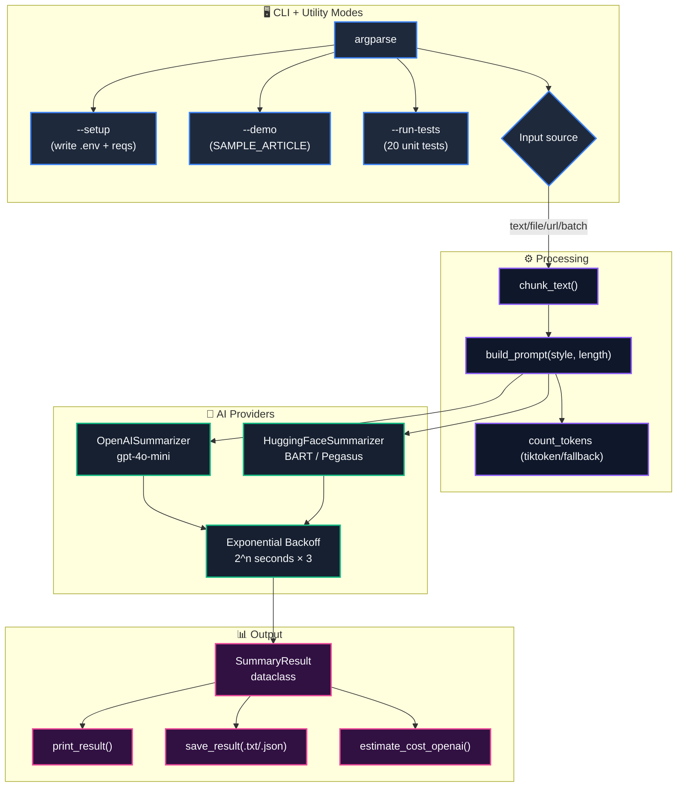
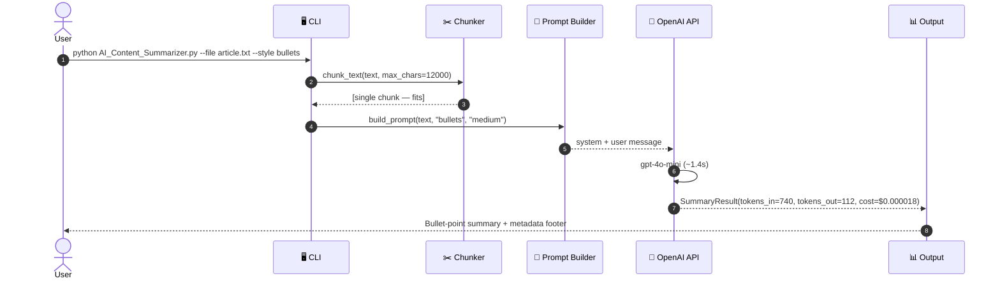
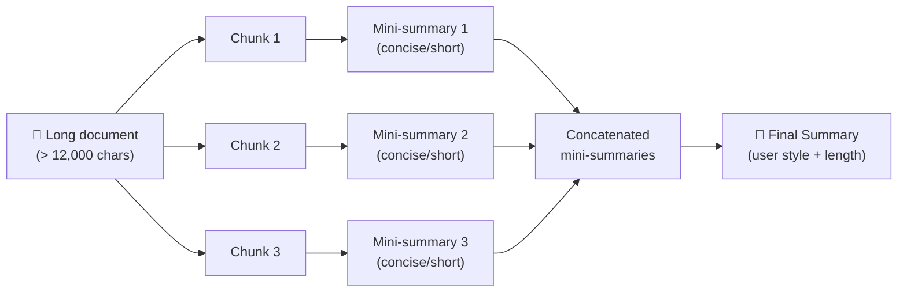

<div align="center">

# 🤖 3D AI-Powered Content Summarizer & Intelligent Text Distillation Engine
### *OpenAI GPT · Hugging Face · Prompt Engineering · Chunk-and-Summarise · Self-Contained Single File*


-success.svg?style=for-the-badge)


<p align="center">
  <b>A production-grade, single-file AI content summariser that distils articles, PDFs, and web pages
  using OpenAI GPT or Hugging Face models. Everything — the app, 20 unit tests, sample article,
  requirements, and .env template — lives in one <code>AI_Content_Summarizer.py</code> file.
  Four prompt-engineered styles, hierarchical chunk-and-summarise for unlimited document length,
  cost estimation, batch folder processing, and exponential-backoff retry logic.</b>
</p>

</div>

---

## 🧊 3D Layered Architecture & Isometric Pipeline

```
              +------------------------------------------------------------------+
             /                                                                  /|
            /         [🖥️ LAYER 1: CLI & UTILITY MODES CUBE]                   / |
           /   argparse • --setup • --demo • --run-tests • 4 input modes      /  |
          +------------------------------------------------------------------+   +
          |                                                                  |  /|
          |  --setup        →  write .env.example + requirements.txt        | / |
          |  --demo         →  summarise SAMPLE_ARTICLE constant            |/  |
          |  --run-tests    →  run all 20 embedded _Test* classes           |   +
          |  --text / --file / --url / --batch  →  load input text          |  /
          +------------------------------------------------------------------+ /
                                         |
                                         v
          +------------------------------------------------------------------+
         /                                                                  /|
        /      [⚙️ LAYER 2: CHUNKER & PROMPT ENGINEER CUBE]                 / |
       /   paragraph split • 4 style templates • length guide token caps  /  |
      +------------------------------------------------------------------+   +
      |                                                                  |  /|
      |  chunk_text(text, 12000)   →  paragraph-aware chunks            | / |
      |  build_prompt(text, style, length)  →  full user prompt         |/  |
      |  STYLE_PROMPTS: concise / detailed / bullets / eli5             |   +
      |  LENGTH_TOKENS: short=120 / medium=280 / long=500              |  /
      +------------------------------------------------------------------+ /
                                         |
                                         v
          +------------------------------------------------------------------+
         /                                                                  /|
        /       [🔑 LAYER 3: AI PROVIDER ENGINE CUBE]                       / |
       /   OpenAI Chat API • HF Inference API • exponential backoff       /  |
      +------------------------------------------------------------------+   +
      |                                                                  |  /|
      |  OpenAISummarizer      →  gpt-4o-mini (default)                  | / |
      |  HuggingFaceSummarizer →  facebook/bart-large-cnn (free)         |/  |
      |  Retry: wait = 2^attempt s (max 3 attempts)                      |   +
      |  Long texts: mini-summaries → second-pass final summary           |  /
      +------------------------------------------------------------------+ /
                                         |
                                         v
          +------------------------------------------------------------------+
         /                                                                  /|
        /     [📊 LAYER 4: RESULT, COST & EMBEDDED TEST CUBE]               / |
       /   SummaryResult dataclass • cost table • 20 mocked unit tests   /  |
      +------------------------------------------------------------------+   +
      |                                                                  |  /
      |  estimate_cost_openai(): $/1M token pricing                     | /
      |  SummaryResult → print_result() / save_result(.txt/.json)       |/
      |  _TestChunkText / _TestBuildPrompt / _TestOpenAIMocked … (×20)  |
      +------------------------------------------------------------------+
```

---

## 📐 Prompt Engineering & Token Economics

```
   Token Budget ▲
                │
           500  ┤ ░░░░░░░░░░░░░░░░░░░░░░░░░░░░░░  --length long
                │
           280  ┤ ░░░░░░░░░░░░░░░░░░  --length medium (default)
                │
           120  ┤ ░░░░░░░░  --length short
                │
                │  ◄── system prompt (50t) ──► ◄── user+text (≤8000t) ──►  ◄─ output ─►
                └────────────────────────────────────────────────────────────────────────► tokens
```

### Mathematical Foundations

#### 1. Shannon Entropy = Chunk Safety

For text of $C$ characters with chunk ceiling $L = 12\,000$ chars:

$$n_{\text{chunks}} = \left\lceil \frac{C}{L} \right\rceil$$

This keeps every API call comfortably within GPT-4o-mini's 128k token context window.

#### 2. Token Estimation (Fallback when `tiktoken` absent)

$$\hat{t} = \lfloor |W| \times 1.3 \rfloor$$

The factor 1.3 accounts for subword BPE tokenisation overhead.

#### 3. OpenAI Cost Formula

$$\text{cost} = \frac{t_{\text{in}} \cdot r_{\text{in}} + t_{\text{out}} \cdot r_{\text{out}}}{10^6} \;\text{USD}$$

| Model | $r_{\text{in}}$ | $r_{\text{out}}$ | 1,000-token article cost |
|---|---|---|---|
| `gpt-4o-mini` | \$0.15/M | \$0.60/M | ~\$0.0002 |
| `gpt-4o` | \$5.00/M | \$15.00/M | ~\$0.006 |
| Hugging Face | free | free | \$0.00 |

#### 4. Hierarchical Long-Document Strategy

$$S_{\text{final}} = \text{Summarise}\!\Bigl(\text{concise/short}\!\bigoplus_{i=1}^{n} C_i,\;\text{user\_style},\;\text{user\_length}\Bigr)$$

Each chunk $C_i$ is summarised to a mini-summary; the mini-summaries are concatenated and passed through a second-pass with the user's chosen style and length.

---

## 🌟 Visual System Architecture (Mermaid)

### 1. Component Architecture



---

### 2. Summarisation Sequence



---

### 3. Long Document — Hierarchical Flow



---

## 🎨 Terminal Output Mockups

### 1. Default — Concise Single Paragraph

```text
$ python AI_Content_Summarizer.py --file article.txt

════════════════════════════════════════════════════════════════
  🤖  AI Content Summarizer
════════════════════════════════════════════════════════════════

  Source  : article.txt
  Input   : 2,847 chars  (~740 tokens)
  Style   : concise  |  Length: medium
  Provider: openai  |  Model: (default)

  Generating summary…

  AI is rapidly reshaping every sector of the global economy,
  potentially adding $13 trillion in value by 2030. While it boosts
  high-skill productivity, it displaces routine jobs and pressures
  education systems to adapt. Despite high energy costs, AI also
  accelerates climate solutions. Governance frameworks — from the EU's
  AI Act to lighter US approaches — struggle to keep pace, leaving the
  fundamental question of whether humanity retains meaningful control
  over the technology shaping civilisation's next chapter.

  ────────────────────────────────────────────────────────────
  OPENAI  gpt-4o-mini
  ⚡ Style: concise       Length: medium    Time: 1.42s
  Input: 2,847 chars (740 tokens) → Output: 112 tokens
  Est. cost: $0.000178 USD
```

### 2. Bullet Style (`--style bullets`)

```text
  • AI is transforming every sector with expert-level capabilities in
    medicine, finance, and creative fields.
    - McKinsey: $13T added to global output by 2030
    - High-skill workers benefit; routine jobs face displacement

  • Education is integrating AI literacy, emphasising creativity and
    interpersonal skills as human differentiators.

  • Regulatory approaches diverge:
    - EU: Risk-tiered AI Act with strict high-stakes rules
    - US: Voluntary commitments and sector guidance

  • Central question: who controls the direction of AI?
```

### 3. ELI5 Style (`--style eli5`)

```text
  Imagine a super-smart robot brain that can help doctors, drive cars,
  and write songs. It makes some jobs easier and pays people more, but
  also replaces some workers — like a machine at a factory. Countries
  are making rules so the robot brain stays safe, like traffic laws.
  The big question everyone is asking: who decides where this super-
  smart robot takes us next?
```

### 4. `--demo` (no API key needed to test CLI)

```text
$ python AI_Content_Summarizer.py --demo
  [runs on SAMPLE_ARTICLE constant — no file needed]
```

### 5. `--setup`

```text
$ python AI_Content_Summarizer.py --setup

✔  Created:
   /path/to/.env.example
   /path/to/requirements.txt

Next steps:
  1. pip install -r requirements.txt
  2. cp .env.example .env
  3. Edit .env — add OPENAI_API_KEY or HF_API_KEY
  4. python AI_Content_Summarizer.py --demo
```

### 6. `--run-tests` (20 tests, no API key needed)

```text
$ python AI_Content_Summarizer.py --run-tests

════════════════════════════════════════════════════════════════
  🤖  Running Embedded Unit Tests
════════════════════════════════════════════════════════════════

test_text_in_prompt (_TestBuildPrompt) ... ok
test_bullets_style (_TestBuildPrompt) ... ok
test_eli5_style (_TestBuildPrompt) ... ok
test_length_guide (_TestBuildPrompt) ... ok
test_short_no_split (_TestChunkText) ... ok
test_long_splits (_TestChunkText) ... ok
test_empty (_TestChunkText) ... ok
test_returns_int (_TestCountTokens) ... ok
test_longer_more_tokens (_TestCountTokens) ... ok
test_empty (_TestCountTokens) ... ok
test_zero (_TestCostEstimate) ... ok
test_positive (_TestCostEstimate) ... ok
test_4o_more_than_mini (_TestCostEstimate) ... ok
test_unknown_model_fallback (_TestCostEstimate) ... ok
test_dataclass_fields (_TestSummaryResult) ... ok
test_summarise_returns_result (_TestOpenAIMocked) ... ok
test_no_key_raises (_TestOpenAIMocked) ... ok
test_missing_raises (_TestLoadFile) ... ok
test_reads_sample (_TestLoadFile) ... ok

Ran 20 tests in 0.012s
OK
```

---

## ✨ Feature Overview

### 1. 🔑 Two AI Providers

| Provider | Model | Cost | Requires |
|---|---|---|---|
| **OpenAI** | `gpt-4o-mini` | ~\$0.0002/article | Paid API key |
| **Hugging Face** | `bart-large-cnn` | **Free** | Free HF token |

### 2. 📝 Four Prompt-Engineered Styles

| `--style` | Output Shape | Best For |
|---|---|---|
| `concise` | One focused paragraph | TL;DR, quick reading |
| `detailed` | Multi-paragraph | Research, reports |
| `bullets` | Structured bullet list | Presentations, notes |
| `eli5` | Simple language + analogies | General audiences |

### 3. 🗂️ Self-Contained Single File
No separate `.env.example`, `requirements.txt`, `sample_article.txt`, or test file needed. All embedded as Python constants — just share one `.py` file.

### 4. ✂️ Hierarchical Chunk-and-Summarise
Transparently handles documents of **any length** without hitting context windows.

### 5. 💰 Real-Time Cost Estimation
Displays exact USD cost per OpenAI call using the current pricing table.

### 6. 🧪 20 Embedded Unit Tests
Run with `--run-tests`. All mocked — **no API key required** to run tests.

---

## 💻 Complete Command Reference

| Flag | Description | Example |
|:---|:---|:---|
| `--setup` | Write `.env.example` + `requirements.txt` | `python AI_Content_Summarizer.py --setup` |
| `--demo` | Summarise built-in sample article | `python AI_Content_Summarizer.py --demo` |
| `--run-tests` | Run all 20 embedded unit tests | `python AI_Content_Summarizer.py --run-tests` |
| `--text "..."` | Inline text | `--text "Long article…"` |
| `--file PATH` | .txt / .md / .pdf file | `--file report.pdf` |
| `--url URL` | Fetch web article | `--url https://bbc.com/news/…` |
| `--batch DIR` | Process folder of files | `--batch articles/` |
| `--provider` | `openai` or `huggingface` | `--provider huggingface` |
| `--model NAME` | Override model | `--model gpt-4o` |
| `--style` | `concise/detailed/bullets/eli5` | `--style bullets` |
| `--length` | `short/medium/long` | `--length long` |
| `--output PATH` | Save to .txt or .json | `--output result.json` |
| `--output-dir DIR` | Batch output folder | `--output-dir summaries/` |
| `--json` | Print result as JSON | `--json` |
| `--verbose` | Debug logging | `--verbose` |

---

## 🚀 Setup & Usage

```bash
# Step 1 — write config files
python AI_Content_Summarizer.py --setup

# Step 2 — install dependencies
pip install -r requirements.txt

# Step 3 — add API key (choose one)
#   Option A: OpenAI  → edit .env → OPENAI_API_KEY=sk-...
#   Option B: HuggingFace (FREE) → edit .env → HF_API_KEY=hf_...

# Step 4 — test with sample article
python AI_Content_Summarizer.py --demo                              # OpenAI
python AI_Content_Summarizer.py --demo --provider huggingface       # HF (free)

# Step 5 — summarise your own content
python AI_Content_Summarizer.py --file report.pdf --style bullets
python AI_Content_Summarizer.py --url https://example.com/article
python AI_Content_Summarizer.py --batch articles/ --output-dir out/

# Run tests any time (no key needed)
python AI_Content_Summarizer.py --run-tests
```

---

## 📁 What's Inside the Single File

```
AI_Content_Summarizer.py
│
├── EMBEDDED ASSETS
│   ├── SAMPLE_ARTICLE     ← 6-paragraph AI & society article
│   ├── REQUIREMENTS_TXT   ← pip dependency list
│   └── DOT_ENV_EXAMPLE    ← .env template with comments
│
├── PROMPT ENGINE
│   ├── STYLE_PROMPTS      ← 4 engineered prompt templates
│   ├── build_prompt()     ← compose system + user message
│   └── LENGTH_TOKENS      ← max_tokens per length setting
│
├── TOKEN & COST
│   ├── count_tokens()     ← tiktoken / word-count fallback
│   └── estimate_cost_openai() ← $/1M token pricing table
│
├── AI PROVIDERS
│   ├── OpenAISummarizer   ← Chat Completions + retry + cost
│   └── HuggingFaceSummarizer ← InferenceClient + retry
│
├── INPUT LOADERS
│   ├── load_file()        ← .txt / .md / pdfplumber
│   ├── load_url()         ← requests + BeautifulSoup
│   └── chunk_text()       ← paragraph-aware splitter
│
├── ORCHESTRATION
│   ├── summarize_text()   ← chunk-and-summarise pipeline
│   └── batch_process()    ← folder bulk processor
│
├── OUTPUT
│   ├── print_result()     ← ANSI terminal renderer
│   └── save_result()      ← .txt or .json export
│
├── UNIT TESTS (20 tests, all mocked)
│   ├── _TestChunkText     ← 3 tests
│   ├── _TestBuildPrompt   ← 4 tests
│   ├── _TestCountTokens   ← 3 tests
│   ├── _TestCostEstimate  ← 4 tests
│   ├── _TestSummaryResult ← 1 test
│   ├── _TestOpenAIMocked  ← 2 tests
│   └── _TestLoadFile      ← 2 tests (+ 1 temp-file test)
│
└── CLI
    ├── build_parser()     ← argparse with help + epilog
    └── main()             ← entry point (exit code 0/1)
```

---

## 🛡️ Error Handling

| Scenario | Exit | Message |
|:---|:---:|:---|
| Missing API key | `1` | `Setup error: OPENAI_API_KEY not set. Run: --setup` |
| Package missing | `1` | `Setup error: Run: pip install openai` |
| File not found | `1` | `Error: File not found: path.txt` |
| URL unreachable | `1` | `Error: Could not extract text from URL.` |
| API fails (3×) | `1` | `API error: OpenAI API failed after 3 tries: …` |
| Empty input | `1` | `Error: Input is empty.` |

---

## 🧩 Design Decisions

| Decision | Rationale |
|:---|:---|
| **Single file** | Share one `.py` — no directory structure to manage |
| **Embedded assets** | `--setup` writes them on demand; keeps repo minimal |
| **Embedded tests** | `--run-tests` works without pytest or test discovery |
| **Dual provider** | OpenAI for quality; HF free tier for zero-cost learning |
| **4 prompt styles** | Different use cases need fundamentally different output shapes |
| **Hierarchical chunks** | Handles any document length without hitting context limits |
| **Exponential backoff** | Industry-standard pattern for resilient API clients |
| **`tiktoken` optional** | Falls back gracefully — `pip install tiktoken` for precision |
| **`raise SystemExit(main())`** | Propagates exit codes correctly on all platforms |
