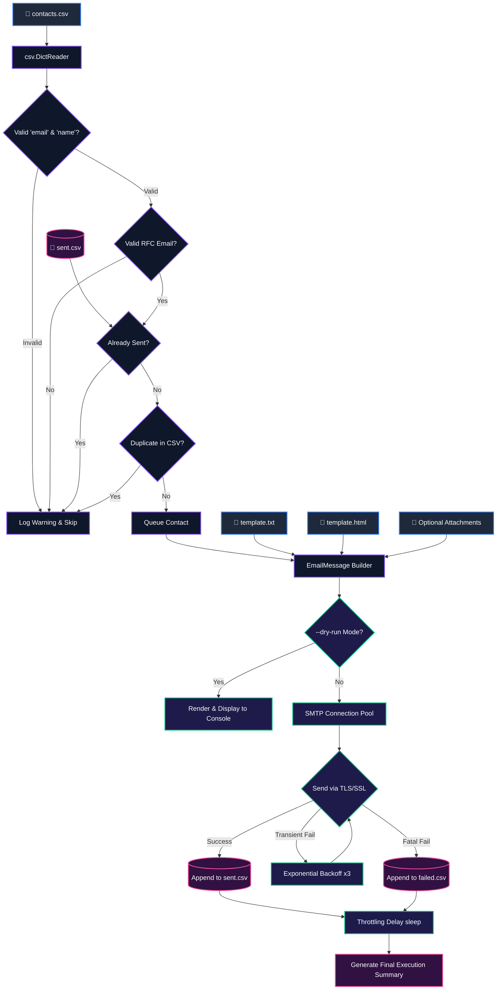
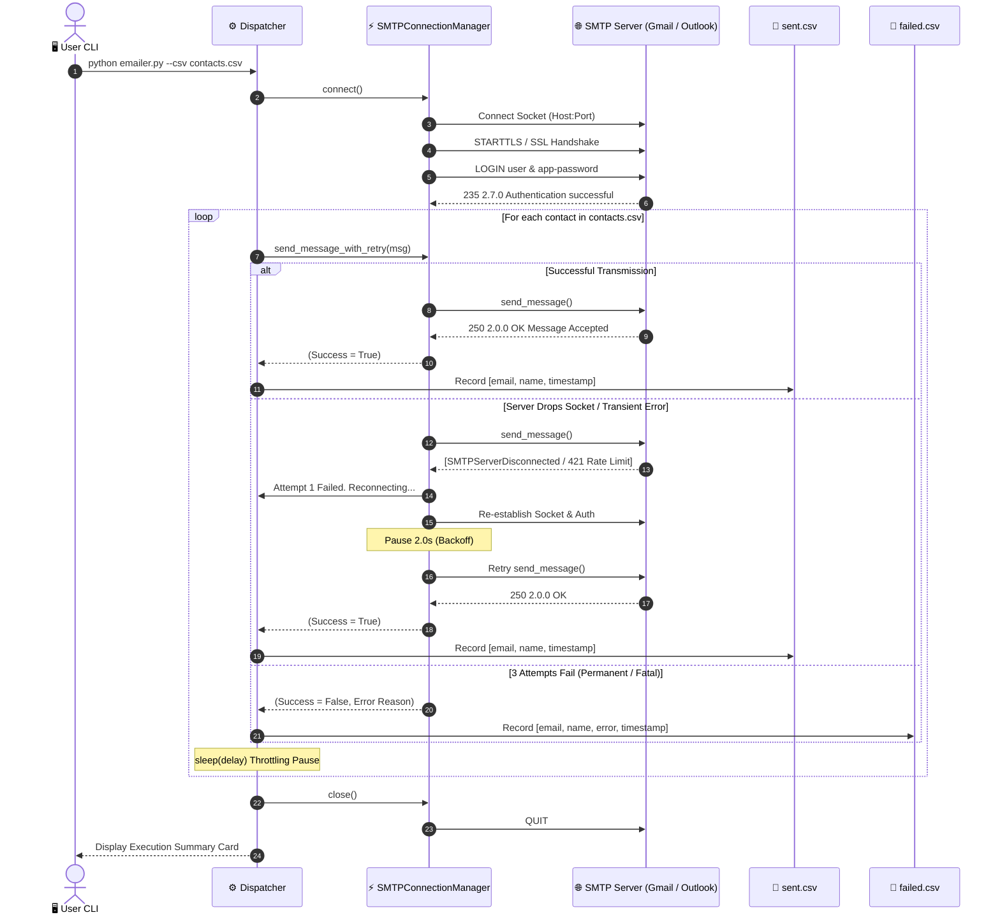

<div align="center">

# 📧 3D Automated Bulk Emailer & SMTP Dispatch Engine
### *Zero-Dependency Python 3.10+ Standard Library • Safe Template Interpolation • Resilient SMTP Reconnection • Rate-Limiting Guardrails*


-brightgreen.svg?style=for-the-badge)


<p align="center">
  <b>A production-ready, enterprise-grade Bulk Email Dispatcher built exclusively with Python standard library primitives. Features CSV contact parsing with schema validation and case-insensitive de-duplication, safe <code>string.Template</code> variable substitution, multipart plain-text + HTML emails, exponential backoff retries, persistent SMTP connection pooling, throttling delays, and stateful sent/failed audit logging.</b>
</p>

</div>

---

## 🧊 3D System Architecture & Isometric Pipeline

```
                               +-------------------------------------------------------------+
                              /                                                             /|
                             /          [📦 LAYER 1: CSV INGESTION & AUDIT CUBE]            / |
                            /  csv.DictReader • Regex Email Validation • De-Duplication     /  |
                           +-------------------------------------------------------------+   +
                           |                                                             |  /|
                           |  • Mandatory Columns: 'email', 'name'                       | / |
                           |  • Dynamic Columns: 'company', 'city', 'role', etc.         |/  |
                           |  • Case-Insensitive Normalization & Duplicate Elimination   |   +
                           |  • Stateful Check: Skips contacts recorded in sent.csv      |  /
                           +-------------------------------------------------------------+ /
                                                          |
                                                          v
                               +-------------------------------------------------------------+
                              /                                                             /|
                             /       [📝 LAYER 2: SAFE TEMPLATING & MIME ENGINE CUBE]       / |
                            /   string.Template safe_substitute • EmailMessage RFC 5322     /  |
                           +-------------------------------------------------------------+   +
                           |                                                             |  /|
                           |  • Variables: ${name}, ${company}, ${city}, etc.            | / |
                           |  • Fallback Safety: Unmatched placeholders never raise keys |/  |
                           |  • Multipart/Alternative: text/plain + text/html payloads   |   +
                           |  • MIME Auto-Detection: Binary attachments with guessed type|  /
                           |  • Compliance: RFC 2369 List-Unsubscribe & opt-out footer   | /
                           +-------------------------------------------------------------+ /
                                                          |
                                                          v
                               +-------------------------------------------------------------+
                              /                                                             /|
                             /       [⚡ LAYER 3: RESILIENT SMTP DISPATCH & RETRY CUBE]      / |
                            /   smtplib.SMTP / SMTP_SSL • Reconnection • Exponential Backoff/  |
                           +-------------------------------------------------------------+   +
                           |                                                             |  /|
                           |  • Encryption: Port 465 (SMTP_SSL) & Port 587 (STARTTLS)   | / |
                           |  • Reusable Connection: Single socket reused across batch   |/  |
                           |  • Auto-Reconnection: Recovers immediately if pipe drops    |   +
                           |  • Exponential Backoff: Transient retry (2^k seconds, 3 att)|  /
                           +-------------------------------------------------------------+ /
                                                          |
                                                          v
                               +-------------------------------------------------------------+
                              /                                                             /|
                             /       [📊 LAYER 4: RATE LIMITING, AUDIT & LOGGING CUBE]      / |
                            /    Delay Throttling • Batch Pausing • sent.csv & failed.csv   /  |
                           +-------------------------------------------------------------+   +
                           |                                                             |  /
                           |  • Rate Limiting: Configurable inter-message delay (--delay)| / 
                           |  • Batch Throttling: Pause between batches (--batch-size)   |/  
                           |  • Resumption Ledger: sent.csv & failed.csv for idempotency |   
                           |  • Unified Logging: Timestamped console & emailer.log audit |   
                           +-------------------------------------------------------------+   
```

---

## 📐 Mathematical Throttling & Exponential Backoff Foundations

To protect sender domain reputation and adhere strictly to ISP rate limits, the dispatcher models sending throughput and transient network failures mathematically:

```
          Transmission Delay (Seconds) ▲
                                       │
                                       │                                 ▲ Fatal Threshold
                                       │                                ╱ (Mark in failed.csv)
                                       │                     Attempt 3 ╱
                                       │                      (8.0s)  ●
                                       │                             ╱
                                       │                 Attempt 2  ╱
                                       │                  (4.0s)   ●
                                       │                          ╱
                                       │              Attempt 1  ╱
                                       │               (2.0s)   ●
                                       │                       ╱
                                       │  Normal Delay (1.0s) ╱
                                       │  ═══════════════════●
                                       └────────────────────────────────────────► Network Event
                                      ╱
                                     ╱  [Transient Disconnection / SMTPServerDisconnected]
                                    ▼ Retry Count (k ∈ {1, 2, 3})
```

### 1. Exponential Backoff Formula
When a transient socket interruption, timeout, or temporary `4xx` SMTP status occurs on attempt $k$, the client pauses for duration $t_k$:
$$t_k = b^k \quad \text{where } b = 2.0, \quad k \in \{1, 2, 3\}$$
If $k > 3$, the transaction is marked as a fatal failure, recorded in `failed.csv` with the exception trace, and the run proceeds without interruption.

### 2. Throughput & Batch Throttling Equation
For a list of $N$ contacts dispatched with delay $d$ and batch rest interval $p$ every $B$ emails:
$$T_{\text{estimated}} = (N \times d) + \left( \left\lfloor \frac{N}{B} \right\rfloor \times p \right)$$

---

## 🌟 Visual Pipeline & Lifecycles (Mermaid)

### 1. System Component Flow



---

### 2. SMTP Connection & Reconnection Sequence Diagram



---

## 🎨 Rich Terminal UI & Output Preview

```text
[2026-11-07 00:49:05] [INFO   ] Initializing Automated Bulk Emailer...
[2026-11-07 00:49:05] [INFO   ] Parsed 5 valid contact(s) from 'contacts.csv' (0 skipped).
[2026-11-07 00:49:05] [INFO   ] Connecting to SMTP server at smtp.gmail.com:587 (SSL: False, STARTTLS: True)...
[2026-11-07 00:49:06] [INFO   ] SMTP Authentication successful.
[2026-11-07 00:49:06] [INFO   ] [1/5] Preparing email for Alice Johnson <alice.johnson@example.com>...
[2026-11-07 00:49:07] [INFO   ] Successfully sent to alice.johnson@example.com.
[2026-11-07 00:49:08] [INFO   ] [2/5] Preparing email for Bob Smith <bob.smith@example.com>...
[2026-11-07 00:49:09] [INFO   ] Successfully sent to bob.smith@example.com.

====================================================================
                    EXECUTION SUMMARY
====================================================================
  Total Parsed Contacts:  5
  Successfully Sent:      5
  Failed Transmissions:   0
  Skipped / Filtered:     0
  Elapsed Duration:       5.12 seconds
====================================================================
```

---

## 🚀 Quickstart & Setup Guide

### 1. Clone & Configure Environment

Create your local `.env` configuration file from the provided example:

```bash
cp .env.example .env
```

Edit `.env` with your SMTP credentials:

```ini
SMTP_HOST=smtp.gmail.com
SMTP_PORT=587
SMTP_USER=your_email@gmail.com
SMTP_PASSWORD=your_16_character_app_password
SMTP_FROM_NAME="Engineering Lead"
SMTP_FROM_EMAIL=your_email@gmail.com
SMTP_REPLY_TO=support@example.com
```

---

### 2. Prepare Contacts (`contacts.csv`)

Add your recipients to [`contacts.csv`](file:///c:/Users/LOKI/Practice/Python/50%20Mini%20Projects/contacts.csv). Ensure `email` and `name` columns are present. Additional columns become template placeholders:

```csv
email,name,company,city,role
alice.johnson@example.com,Alice Johnson,Acme Corp,New York,Product Manager
bob.smith@example.com,Bob Smith,TechCorp,San Francisco,Engineering Lead
carol.danvers@example.com,Carol Danvers,Star Industries,Chicago,Operations Director
```

---

### 3. Customize Email Templates

- **Plain Text Template** ([`template.txt`](file:///c:/Users/LOKI/Practice/Python/50%20Mini%20Projects/template.txt)): Used as standard body and fallback for plain-text email clients.
- **HTML Template** ([`template.html`](file:///c:/Users/LOKI/Practice/Python/50%20Mini%20Projects/template.html)): Generates responsive HTML email with inline styles and CTA button.

Placeholders like `${name}`, `${company}`, `${city}`, `${role}` are automatically populated from your CSV.

---

## 💻 Command Reference & Usage Examples

### 1. Perform a Dry Run (Recommended First Step)
Renders all emails and outputs them to the console without connecting to SMTP or sending emails:

```bash
python emailer.py --dry-run
```

Preview only the first 2 contacts:
```bash
python emailer.py --dry-run --limit 2
```

---

### 2. Send a Single Test Email to Yourself
Send one real sample email to your own address using the first contact's data:

```bash
python emailer.py --test-to your_personal_email@example.com
```

---

### 3. Dispatch Live Bulk Campaign with Rate Limiting
Send emails with a 1.5-second delay between recipients and take a rest every 25 emails:

```bash
python emailer.py --csv contacts.csv --delay 1.5 --batch-size 25
```

---

### 4. Custom Subject & Attachments
Send an email with custom subject placeholders and attach files (e.g. PDF brochure):

```bash
python emailer.py --subject "Special invitation for ${name} at ${company}" --attach brochure.pdf
```

---

## 🌐 SMTP Provider Settings Matrix

| Provider | Host | Port | Encryption | Username | Password Requirement | Free Quota |
| :--- | :--- | :---: | :---: | :--- | :--- | :--- |
| **Gmail / G Suite** | `smtp.gmail.com` | `587` | STARTTLS | Full Gmail address | **16-char App Password** *(2FA required)* | ~500 / day |
| **Gmail SSL** | `smtp.gmail.com` | `465` | SSL | Full Gmail address | **16-char App Password** *(2FA required)* | ~500 / day |
| **Outlook / M365** | `smtp.office365.com`| `587` | STARTTLS | Microsoft account email | Account password / App Password | ~300 / day |
| **SendGrid** | `smtp.sendgrid.net` | `587` | STARTTLS | `apikey` | SendGrid API Key string | 100 / day (Free) |
| **Mailgun** | `smtp.mailgun.org` | `587` | STARTTLS | SMTP login from Mailgun | SMTP password from Mailgun | Plan dependent |
| **Amazon SES** | `email-smtp.us-east-1.amazonaws.com` | `587` | STARTTLS | IAM SMTP Username | IAM SMTP Password | 62,000 / mo |

---

## 🛡️ CAN-SPAM, GDPR & Deliverability Compliance

> [!IMPORTANT]
> **Consent & Permission**: Bulk email tools should only be used to send communications to recipients who have explicitly consented (opted in). Sending unsolicited commercial email violates provider Terms of Service and legal frameworks (CAN-SPAM Act, GDPR, CASL).

1. **Unsubscribe Mechanism**: Both `template.txt` and `template.html` include clear opt-out instructions.
2. **RFC 2369 Header**: Every generated email automatically sets the `List-Unsubscribe` header:
   ```text
   List-Unsubscribe: <mailto:unsubscribe@example.com?subject=unsubscribe>
   ```
3. **Sender Identification**: The `From` and `Reply-To` headers must accurately identify your organization.
4. **Idempotency & Resumption Protection**: 
   - Every successfully delivered message appends a row to `sent.csv`.
   - Running the campaign again **automatically skips** contacts in `sent.csv`, guaranteeing no recipient is ever emailed twice.
   - Any transient or permanent failure records the exact error in `failed.csv` for targeted follow-up.

---

## 🔧 Troubleshooting & Common Issues

### 1. `smtplib.SMTPAuthenticationError: (535, '5.7.8 Username and Password not accepted')`
- **Cause**: Using your normal Google password instead of a dedicated App Password.
- **Fix**: Go to **Google Account** > **Security** > **2-Step Verification** > **App passwords**. Generate an App Password for "Mail" and paste the 16-character string into `SMTP_PASSWORD` in your `.env`.

### 2. `TimeoutError` or `ConnectionRefusedError`
- **Cause**: Port 587 or 465 blocked by local firewall or ISP.
- **Fix**: Try toggling between port 587 (STARTTLS) and port 465 (SSL) in `.env`:
  ```ini
  SMTP_PORT=465
  SMTP_USE_SSL=true
  SMTP_USE_TLS=false
  ```

### 3. `SMTP 421 / 450: Rate limit exceeded`
- **Cause**: Sending too fast for your provider's threshold.
- **Fix**: Increase the `--delay` parameter (e.g. `--delay 2.5`) and decrease `--batch-size` (e.g. `--batch-size 20`).

---

## 🧪 Comprehensive Unit Test Suite

The test suite is built on standard library `unittest`:

```bash
python -m unittest tests/test_emailer.py -v
```

### Verified Test Cases:
- [x] Email validation regex for standard, subdomain, and plus-address formats.
- [x] Rejection of malformed emails without `@`, domain, or username.
- [x] CSV parsing with required `email` and `name` columns.
- [x] Preservation of arbitrary custom columns (`company`, `city`, `role`).
- [x] Case-insensitive email de-duplication within the CSV file.
- [x] Automatic skipping of contacts already listed in `sent.csv`.
- [x] Error handling on missing, empty, or headerless CSV files.
- [x] `string.Template` interpolation with `safe_substitute` for missing fields.
- [x] RFC 5322 compliance (`From`, `To`, `Subject`, `Date`, `Message-ID`, `List-Unsubscribe`).
- [x] Multipart/alternative MIME construction (text/plain + text/html).
- [x] Automatic MIME detection and binary attachment encoding.
- [x] `.env` key-value parsing, quote stripping, and comment skipping.
