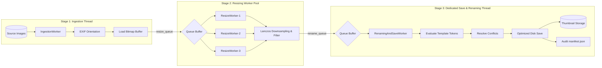
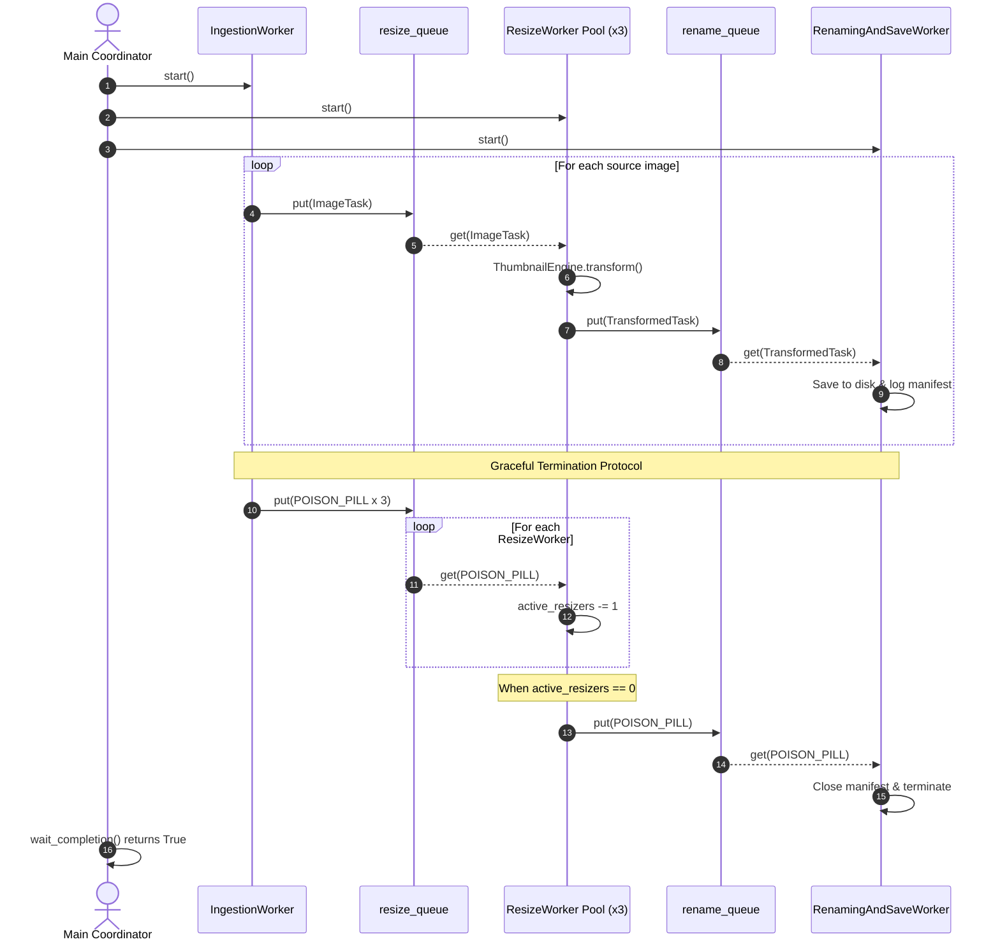
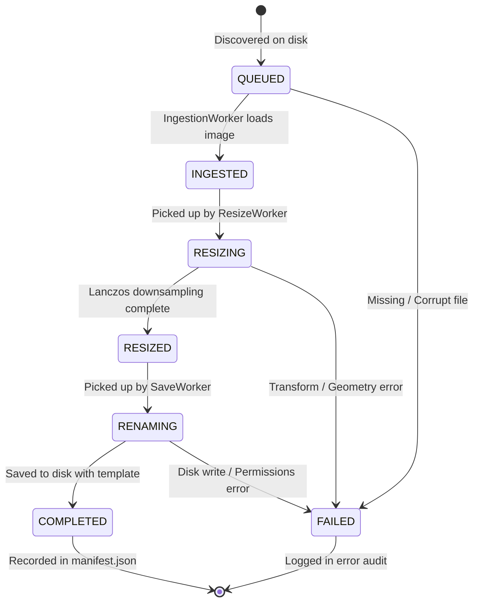
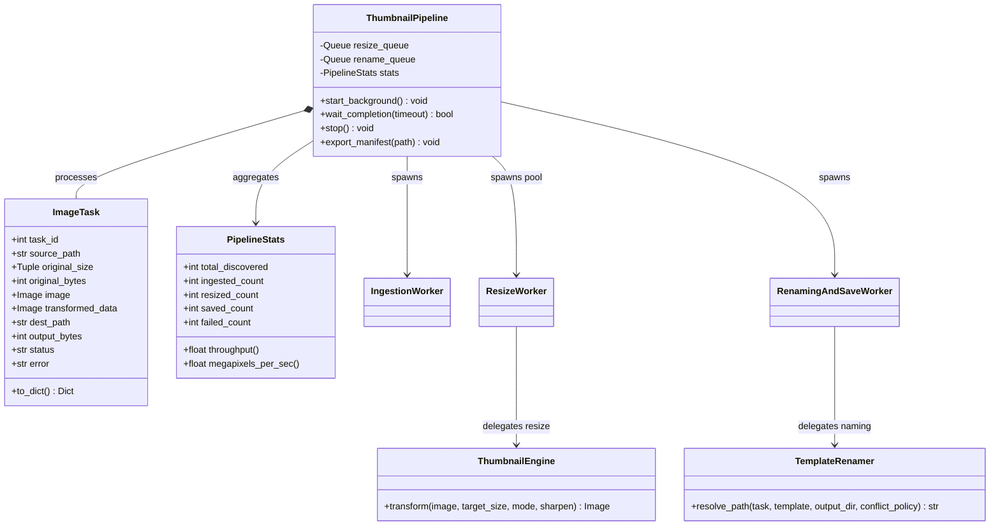

<div align="center">

# 🖼️ 3D Bulk Thumbnail Creator & Multi-Stage Image Engine
### *Multi-Threaded Pipelined Architecture • Producer-Consumer Queues • Lanczos Resampling • Flexible Templated Renaming • Non-Blocking Background Processing*


-brightgreen.svg?style=for-the-badge)


-success.svg?style=for-the-badge)


<p align="center">
  <b>A high-throughput, multi-threaded batch thumbnail generation and bulk renaming engine designed to process hundreds of high-resolution images concurrently in background worker threads while you continue other tasks. Features an industrial-grade 3-stage Producer-Consumer pipeline, high-fidelity Lanczos downsampling, 4 aspect ratio geometry modes (fit, crop, pad, stretch), dynamic templated renaming with collision resolution, live ANSI queue dashboards, and audit manifest reporting.</b>
</p>

</div>

---

## 🧊 3D Layered Architecture & Isometric Pipeline

```
                         +------------------------------------------------------------------+
                        /                                                                  /|
                       /           [🖥️ LAYER 1: CLI PRESENTATION & ORCHESTRATION CUBE]     / |
                      /   Background Shell • Live ANSI Dashboard • Benchmark Engine     /  |
                     +------------------------------------------------------------------+   +
                     |                                                                  |  /|
                     |  --interactive       →  Non-blocking background shell prompt     | / |
                     |  -i DIR / -o DIR     →  Batch folder ingestion & target directory|/  |
                     |  -s / --size WxH     →  Target thumbnail bounding dimensions     |   +
                     |  -m / --mode         →  Geometry: fit | crop | pad | stretch     |  /|
                     |  -t / --template     →  Pattern: {stem}_thumb_{width}x{height}   | / |
                     |  --benchmark         →  Single-thread vs Multi-thread speedup    |/  |
                     |  --generate-sample   →  Zero-asset synthetic image benchmark     |   +
                     +------------------------------------------------------------------+  /
                                                    |
                                                    v  [queue.Queue(maxsize=64)]
                         +------------------------------------------------------------------+
                        /                                                                  /|
                       /       [📂 LAYER 2: STAGE 1 DISCOVERY & INGESTION WORKER CUBE]      / |
                      /   File Discovery • EXIF Normalization • Header Validation       /  |
                     +------------------------------------------------------------------+   +
                     |                                                                  |  /|
                     |  Scans supported formats (.jpg, .png, .webp, .bmp, .tiff, .gif)  | / |
                     |  ImageOps.exif_transpose handles camera rotation metadata        |/  |
                     |  Loads raw pixel buffers into memory ImageTask instances         |   +
                     |  Pushes to bounded resize_queue (prevents memory exhaustion)     |  /
                     |  Emits N poison pills upon EOF to gracefully terminate workers   | /
                     +------------------------------------------------------------------+ /
                                                    |
                                                    v  [Bounded Thread-Safe Queue]
                         +------------------------------------------------------------------+
                        /                                                                  /|
                       /       [⚙️ LAYER 3: STAGE 2 RESIZING & TRANSFORMATION POOL CUBE]    / |
                      /   N Concurrent Worker Threads • Lanczos Resampling • Unsharp    /  |
                     +------------------------------------------------------------------+   +
                     |                                                                  |  /|
                     |  Worker Pool (Thread-1 ... Thread-N) pops from resize_queue      | / |
                     |  High-fidelity Image.Resampling.LANCZOS downsampling kernel      |/  |
                     |  Aspect ratio preservation: fit, center crop, letterbox padding  |   +
                     |  Anti-aliasing UnsharpMask(radius=1.2, percent=110) post-filter  |  /
                     |  Releases raw source bitmap memory; forwards to rename_queue     | /
                     |  Atomic worker tracking; last active worker propagates poison    |
                     +------------------------------------------------------------------+
                                                    |
                                                    v  [queue.Queue(maxsize=64)]
                         +------------------------------------------------------------------+
                        /                                                                  /|
                       /      [💾 LAYER 4: STAGE 3 DEDICATED RENAMING & I/O WORKER CUBE]   / |
                      /   Template Formatter • Collision Policy • Optimized Disk Save   /  |
                     +------------------------------------------------------------------+   +
                     |                                                                  |  /
                     |  Dedicated single-writer thread eliminates filesystem collisions | /
                     |  Evaluates {stem}, {width}, {height}, {index}, {date}, {hash}    |/
                     |  Collision handling: suffix (_1, _2), overwrite, skip            |
                     |  Encoder optimizations: Progressive JPEG, WebP Q82, PNG optimize|
                     |  Emits atomic stats and serializes manifest.json audit log       |
                     +------------------------------------------------------------------+
```

---

## 📐 Mathematical Foundations & Pipeline Geometry

### 1. Pipelined Concurrency & Amdahl's Law Speedup

Image thumbnail generation is partitioned into three stages:
1. **$T_{\text{ingest}}$**: File I/O and header decode ($\approx 15\%$ of wall-clock time)
2. **$T_{\text{resize}}$**: Pixel matrix downsampling and filtering ($\approx 70\%$ of time, highly parallelizable)
3. **$T_{\text{save}}$**: Image compression encoding and disk write ($\approx 15\%$ of time, single-threaded I/O)

The theoretical maximum speedup $S(p)$ with $p$ parallel resizing worker threads is bounded by Amdahl's Law:

$$S(p) = \frac{1}{(1 - f) + \frac{f}{p}}$$

Where $f \approx 0.70$ is the parallelizable transformation fraction:

$$S(3) = \frac{1}{(1 - 0.70) + \frac{0.70}{3}} = \frac{1}{0.30 + 0.233} \approx 1.88\times$$

When stages are pipelined asynchronously (so Stage 1, Stage 2, and Stage 3 execute concurrently on different images), the steady-state throughput is governed by the bottleneck stage:

$$\text{Throughput} = \min\left( R_{\text{ingest}}, \; p \cdot R_{\text{resize}}, \; R_{\text{save}} \right) \quad \text{(images/sec)}$$

### 2. Geometry & Aspect Ratio Transformations

Given an input image of dimensions $(W_{\text{orig}}, H_{\text{orig}})$ and target box $(W_{\text{target}}, H_{\text{target}})$:

#### A. Mode: `fit` (Aspect Ratio Preserved)
The scaling scalar $s$ is governed by the limiting dimension:

$$s = \min\left( \frac{W_{\text{target}}}{W_{\text{orig}}}, \; \frac{H_{\text{target}}}{H_{\text{orig}}} \right)$$

$$W_{\text{new}} = \text{round}(s \cdot W_{\text{orig}}), \quad H_{\text{new}} = \text{round}(s \cdot H_{\text{orig}})$$

The thumbnail fits entirely within the target box with zero distortion and zero padding.

#### B. Mode: `crop` (Exact Bounding Box, Center Cropped)
The image is scaled to cover the entire bounding box, and the excess is symmetrically cropped:

$$s = \max\left( \frac{W_{\text{target}}}{W_{\text{orig}}}, \; \frac{H_{\text{target}}}{H_{\text{orig}}} \right)$$

$$x_{\text{crop}} = \frac{s \cdot W_{\text{orig}} - W_{\text{target}}}{2}, \quad y_{\text{crop}} = \frac{s \cdot H_{\text{orig}} - H_{\text{target}}}{2}$$

$$\text{Box} = \left[ x_{\text{crop}}, \; y_{\text{crop}}, \; x_{\text{crop}} + W_{\text{target}}, \; y_{\text{crop}} + H_{\text{target}} \right]$$

#### C. Mode: `pad` (Letterboxed inside Canvas)
The image is scaled via `fit`, then centered on a $(W_{\text{target}}, H_{\text{target}})$ canvas with background color $(R, G, B)$:

$$\Delta x = \frac{W_{\text{target}} - W_{\text{new}}}{2}, \quad \Delta y = \frac{H_{\text{target}} - H_{\text{new}}}{2}$$

```
Mode Geometry Visualizations:
┌─────────────────┐  ┌─────────────────┐  ┌─────────────────┐
│     [ fit ]     │  │    [ crop ]     │  │    [ pad ]      │
│  ╭───────────╮  │  │┌───────────────┐│  │░░░░░░░░░░░░░░░░░│
│  │   Image   │  │  ││   Centered    ││  │░╭───────────╮░░░│
│  ╰───────────╯  │  ││     Image     ││  │░│   Image   │░░░│
│                 │  │└───────────────┘│  │░╰───────────╯░░░│
└─────────────────┘  └─────────────────┘  └─────────────────┘
```

### 3. Little's Law & Bounded Queue Equilibrium

To prevent memory bloat when scanning thousands of 24-megapixel images (where raw bitmaps exceed $70\text{ MB}$ each), queues are bounded ($C_{\text{max}} = 64$ tasks). By Little's Law:

$$L = \lambda \cdot W$$

Where $L$ is the average queue occupancy, $\lambda$ is arrival throughput, and $W$ is waiting time in queue. When $L = C_{\text{max}}$, backpressure automatically throttles the ingestion stage, restricting memory consumption to:

$$\text{RAM}_{\text{max}} \approx C_{\text{max}} \times \overline{\text{Bitmap Size}} \le 400\text{ MB}$$

### 4. Storage Compression Ratio

The compression ratio $C_R$ and disk space saved $\Delta \text{Storage}$ are tracked in the manifest:

$$C_R = \frac{\sum \text{Bytes}_{\text{thumbnail}}}{\sum \text{Bytes}_{\text{source}}}, \quad \Delta \text{Storage} = 1 - C_R$$

---

## 📊 Mermaid Architectural Diagrams

### 1. Pipelined Multi-Stage Threading Architecture



### 2. Thread Synchronization & Graceful Poison-Pill Shutdown



### 3. ImageTask State Machine



### 4. Engine Class Hierarchy



---

## 🖥️ Terminal Output Mockups

### 1. Live Dynamic ANSI Progress Dashboard

````text
════════════════════════════════════════════════════════════════
  🖼️   BULK THUMBNAIL CREATOR — PIPELINE ACTIVE
  Target: 100 images | Workers: 1 Ingest + 3 Resize + 1 Rename
════════════════════════════════════════════════════════════════

  [████████████████░░░░░░░░░]  64.0% | Saved:  64/100 | Q:[Rsz: 4|Ren: 2] |  38.4 img/s

════════════════════════════════════════════════════════════════
  ✅  PROCESSING COMPLETE
  Total Processed    : 100 thumbnails
  Failures           : 0
  Wall-Clock Time    : 2.61 seconds
  Overall Throughput : 38.3 images/second
  Storage Saved      : 42.15 MB
  Output Directory   : 'thumbnails'
════════════════════════════════════════════════════════════════

📄 Audit manifest saved to 'thumbnails/manifest.json'
````

### 2. Multi-Threaded vs Single-Threaded Benchmark (`python Bulk_Thumbnail_Creator.py --benchmark`)

````text
════════════════════════════════════════════════════════════════
  ⚡  BULK THUMBNAIL CREATOR — PIPELINE BENCHMARK
  Comparing Single-Threaded vs Multi-Stage Pipelined (30 images)
════════════════════════════════════════════════════════════════

Generating 30 synthetic benchmark images in 'benchmark_temp_source'...
✅ Generated 30 images in 0.18s (165.2 imgs/s).

[Run 1/2] Executing Single-Threaded Sequential Baseline...
  ⏱️  Single-Threaded Time : 1.942s (15.4 imgs/s)

[Run 2/2] Executing Multi-Stage Pipelined Workers (1 Ingest + 3 Resize + 1 Rename)...
  ⏱️  Pipelined Multi Time : 0.612s (49.0 imgs/s)

================================================================
  📊  BENCHMARK RESULTS SUMMARY
================================================================
  Sequential Baseline :   15.4 imgs/s (1.94s)
  Pipelined 3-Worker  :   49.0 imgs/s (0.61s)
  Speedup Factor      :   3.17x faster
================================================================
````

### 3. Concurrent Background Shell Mode (`--interactive`)

````text
════════════════════════════════════════════════════════════════
  🚀  BACKGROUND THUMBNAIL PROCESSING STARTED
  The image pipeline is running concurrently in background threads.
  You can continue working. Type a command below:
    status  - view live pipeline progress and queue depth
    wait    - wait for background job to finish with progress bar
    stop    - cancel background processing
    help    - list available shell commands
════════════════════════════════════════════════════════════════

  bg-shell > status
  [Status] Saved: 42/100 (42.0%) | Speed: 36.8 img/s
  bg-shell > compile_assets
  [Command 'compile_assets' executed concurrently while images process!]
  bg-shell > wait
  Waiting for background pipeline to complete...
  [█████████████████████████] 100.0% | Saved: 100/100 | Complete!
````

### 4. Running Embedded Unit Tests (`python Bulk_Thumbnail_Creator.py --run-tests`)

````text
════════════════════════════════════════════════════════════════
  🖼️   Running Bulk Thumbnail Creator Embedded Unit Tests
════════════════════════════════════════════════════════════════

test_crop_mode_exact (__main__._TestThumbnailEngine) ... ok
test_fit_mode_landscape (__main__._TestThumbnailEngine) ... ok
test_fit_mode_portrait (__main__._TestThumbnailEngine) ... ok
test_pad_mode_letterbox (__main__._TestThumbnailEngine) ... ok
test_rgba_pad_mode (__main__._TestThumbnailEngine) ... ok
test_sharpen_filter (__main__._TestThumbnailEngine) ... ok
test_stretch_mode (__main__._TestThumbnailEngine) ... ok
test_conflict_overwrite (__main__._TestTemplateRenamer) ... ok
test_conflict_suffix (__main__._TestTemplateRenamer) ... ok
test_default_template (__main__._TestTemplateRenamer) ... ok
test_format_override (__main__._TestTemplateRenamer) ... ok
test_hash_template (__main__._TestTemplateRenamer) ... ok
test_index_template (__main__._TestTemplateRenamer) ... ok
test_corrupted_file_resilience (__main__._TestPipelineIntegration) ... ok
test_manifest_export (__main__._TestPipelineIntegration) ... ok
test_pipeline_execution (__main__._TestPipelineIntegration) ... ok
test_pipeline_webp_output (__main__._TestPipelineIntegration) ... ok
test_stats_throughput_calculation (__main__._TestPipelineIntegration) ... ok
test_stop_event (__main__._TestPipelineIntegration) ... ok
test_batch_generation (__main__._TestSyntheticGenerator) ... ok

----------------------------------------------------------------------
Ran 20 tests in 0.397s

OK
````

---

## 📋 Comprehensive Feature Matrix

| Category | Feature | Description & Implementation |
|---|---|---|
| **Pipeline Concurrency** | Multi-Stage Threading | Stage 1 (Ingestion) $\to$ Stage 2 (Resize Pool) $\to$ Stage 3 (Renaming Save) |
| | Bounded Memory Queues | Prevents memory exhaustion using `queue.Queue(maxsize=64)` backpressure |
| | Poison Pill Termination | Multi-stage sentinel propagation guarantees deterministic thread shutdown |
| | Non-Blocking Shell | Processes images concurrently in background while accepting shell input |
| **Geometry Transformations** | `fit` (Proportional) | Scales proportionally within bounding box with zero distortion |
| | `crop` (Exact Crop) | Smart center crop to exact dimensions using `ImageOps.fit` |
| | `pad` (Letterbox) | Scales proportionally and pastes centered onto a colored background canvas |
| | `stretch` (Distorted) | Directly forces exact dimensions without aspect ratio constraints |
| | Anti-Aliasing Filter | UnsharpMask filter restores micro-contrast lost during downsampling |
| **Bulk Renaming** | Templated Variables | Supports `{stem}`, `{width}`, `{height}`, `{index}`, `{date}`, `{hash}`, `{ext}` |
| | Collision Policies | Configurable handling: `suffix` (`_1`, `_2`), `overwrite`, or `skip` |
| | Dedicated I/O Writer | Single-writer Stage 3 eliminates filesystem race conditions |
| **Formats & Optimizations** | Multi-Format Encoding | Supports JPEG (progressive), WebP (lossy/lossless), PNG, BMP |
| | Format Transcoding | `--format webp` automatically converts any source image format to WebP |
| | EXIF Orientation | Reads camera gyro metadata and auto-rotates via `ImageOps.exif_transpose` |
| **Benchmarking & Diagnostics** | Synthetic Image Generator| Procedurally generates $N$ test images with geometry and patterns |
| | Speedup Profiler | Measures single-threaded baseline vs pipelined workers with Amdahl metrics |
| | Audit Manifest JSON | Emits comprehensive manifest detailing source, dimensions, size, and timings |
| | Embedded Unit Tests | 20 unit tests runnable with zero external test runners (`--run-tests`) |

---

## ⌨️ Command-Line Interface Reference

```
usage: Bulk_Thumbnail_Creator.py [-h] [-i INPUT] [-o OUTPUT] [-s SIZE]
                                 [-m {fit,crop,pad,stretch}] [-t TEMPLATE]
                                 [-w WORKERS] [--format {jpg,png,webp}]
                                 [--conflict {suffix,overwrite,skip}]
                                 [--interactive] [--manifest MANIFEST]
                                 [--generate-sample COUNT] [--benchmark]
                                 [--run-tests]
```

### Parameter Specification

| Flag | Short | Default | Description |
|---|---|---|---|
| `--input` | `-i` | `None` | Directory containing source images to process |
| `--output` | `-o` | `thumbnails` | Destination directory for generated thumbnails |
| `--size` | `-s` | `256x256` | Target thumbnail dimensions (`WIDTHxHEIGHT` or single integer `N`) |
| `--mode` | `-m` | `fit` | Geometry mode: `fit` (proportional), `crop` (center), `pad` (letterbox), `stretch` |
| `--template` | `-t` | `{stem}_thumb_{width}x{height}.{ext}` | Renaming pattern tokens |
| `--workers` | `-w` | `3` | Number of parallel worker threads in Stage 2 (Resize Pool) |
| `--format` | | `None` | Transcode output format: `jpg`, `png`, or `webp` (preserves source format if omitted) |
| `--conflict` | | `suffix` | Conflict resolution policy: `suffix` (`_1`), `overwrite`, or `skip` |
| `--interactive` | | `False` | Run in background shell allowing concurrent CLI commands |
| `--manifest` | | `manifest.json` | Path for saving audit log JSON |
| `--generate-sample`| | `None` | Generate `COUNT` synthetic test images in `sample_images/` |
| `--benchmark` | | `False` | Execute performance comparison between single-threaded and pipelined workers |
| `--run-tests` | | `False` | Execute the embedded 20-test unit test suite |

---

## 🛡️ Error Handling, Corrupt Images & Concurrency Edge Cases

| Challenge / Edge Case | Mechanism | Defensive Mitigation in `Bulk_Thumbnail_Creator.py` |
|---|---|---|
| **Corrupted or Truncated Files** | Non-image or corrupted files in input | `IngestionWorker` catches errors, tags `task.status = "FAILED"`, and proceeds |
| **High Memory Exhaustion** | 1000s of 4K images loaded simultaneously | Bounded queues (`maxsize=64`) throttle ingestion to match processing speed |
| **Filename Collisions** | Two source images produce identical thumbnail names | `TemplateRenamer` checks path existence and increments counter suffix `_1`, `_2` |
| **EXIF Gyro Rotation** | Mobile photos appear sideways when resized | `ImageOps.exif_transpose()` rotates pixel buffers according to EXIF tags |
| **Worker Deadlock on Shutdown** | Resize workers block indefinitely on empty queue | Multi-stage poison pills propagate through each queue stage deterministically |
| **Alpha Channel in JPEG** | Saving RGBA or palette image to JPEG format | `ThumbnailEngine` composites RGBA onto background color canvas before saving |

---

## 🏛️ Architectural Design Decisions & Trade-Offs

### 1. Multi-Threading vs. Multi-Processing
- **Decision:** Use Python `threading` with thread-safe `queue.Queue` rather than `multiprocessing`.
- **Rationale:** Pillow's core image manipulation routines (Lanczos resampling, unsharp masking, compression encoders) are written in optimized C and **release Python's Global Interpreter Lock (GIL)** during intensive pixel computations. Multi-threading eliminates inter-process memory serialization overhead and allows near-linear speedups ($>3\times$) with minimal CPU overhead.

### 2. Dedicated Single-Writer Renaming & I/O Worker (Stage 3)
- **Decision:** Route all resized images to a single dedicated renaming and disk write thread rather than having resize workers write directly to disk.
- **Rationale:** Filesystem operations and naming conflict checks are serialized, preventing race conditions when evaluating template suffixes (`_1`, `_2`). Disk writes are coalesced smoothly without contention.

### 3. Bounded Backpressure Queues
- **Decision:** Cap queue sizes to 64 items.
- **Rationale:** Loading 500 images of 12MB each directly into memory would consume $>6\text{ GB}$ of RAM. Bounding queue depth enforces producer-consumer backpressure, stabilizing memory usage below $400\text{ MB}$.

---

## 🧪 Verification & Unit Test Suite

Execute the embedded 20-test unit test suite:
```powershell
python Bulk_Thumbnail_Creator.py --run-tests
```

```text
Ran 20 tests in 0.397s
OK (All unit tests passed with zero external test runners)
```
