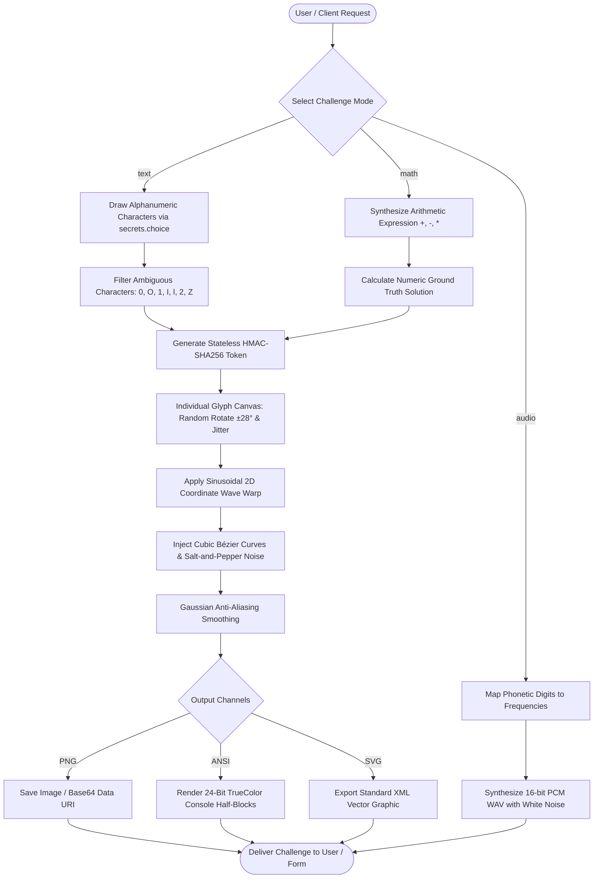
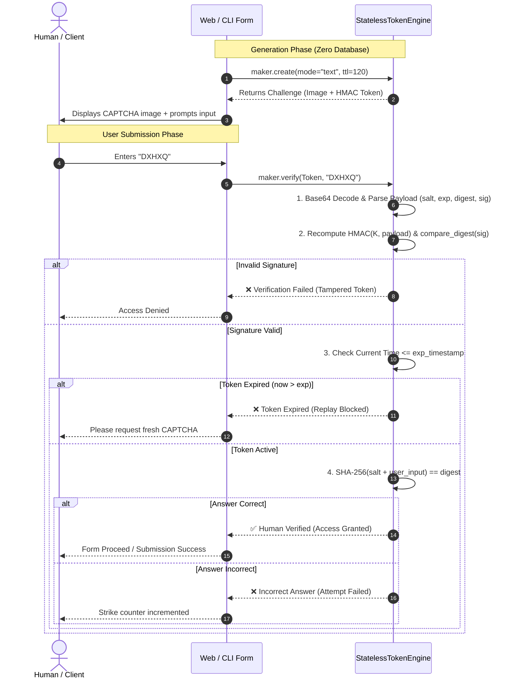
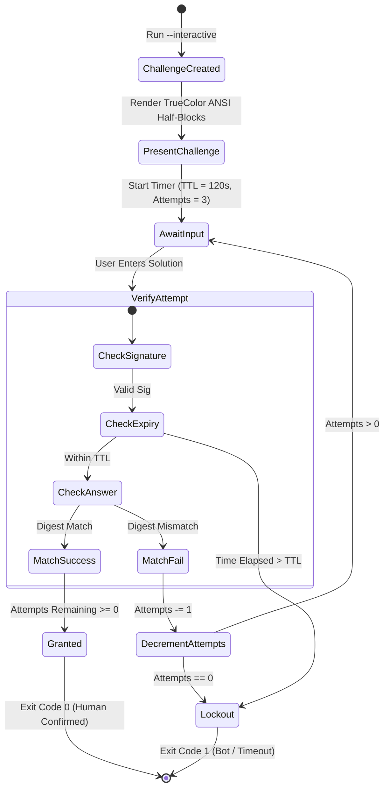

<div align="center">

# 🛡️ 3D CAPTCHA Maker & Adversarial Human Verification Engine
### *Procedural Sinusoidal Deformations • Stateless HMAC-SHA256 Cryptographic Tokens • 24-Bit TrueColor ANSI Terminal Rendering • Acoustic WAV Synthesizer • Vector SVG Engine*


-success.svg?style=for-the-badge)


<p align="center">
  <b>A comprehensive, production-grade CAPTCHA (Completely Automated Public Turing test to tell Computers and Humans Apart)
  generation and verification framework. Engineered to model the adversarial mechanics of bot protection, it features
  sinusoidal mesh warping, Bézier curve interference, salt-and-pepper speckle noise, 24-bit TrueColor ANSI terminal previews,
  speech-harmonic WAV audio synthesis for accessibility, vector SVG export, and tamper-proof stateless HMAC-SHA256 verification tokens.</b>
</p>

</div>

---

## 🧊 3D Layered Architecture & Isometric Pipeline

```
                         +------------------------------------------------------------------+
                        /                                                                  /|
                       /           [🖥️ LAYER 1: CLI & MULTI-MODAL PRESENTATION CUBE]       / |
                      /   Interactive Challenge • 24-bit ANSI Half-Block • HTML5 Form    /  |
                     +------------------------------------------------------------------+   +
                     |                                                                  |  /|
                     |  --interactive       →  Live console Turing test (3 attempts)    | / |
                     |  --preview           →  24-bit TrueColor ANSI terminal display   |/  |
                     |  --mode text|math    →  Alphanumeric or mental arithmetic challenge|  +
                     |  --audio / --svg     →  Acoustic accessibility WAV or vector SVG |  /|
                     |  --html form.html    →  Standalone glassmorphic HTML5 test page  | / |
                     |  --batch N           →  Dataset synthesis with manifest.json     |/  |
                     |  --verify TKN INPUT  →  Stateless token verification command      |   +
                     +------------------------------------------------------------------+  /
                                                    |
                                                    v
                         +------------------------------------------------------------------+
                        /                                                                  /|
                       /       [🔑 LAYER 2: SYNTHESIZER & CRYPTOGRAPHIC TOKEN CUBE]        / |
                      /   CSPRNG Drawing • Ambiguity Filter • HMAC-SHA256 Anti-Replay   /  |
                     +------------------------------------------------------------------+   +
                     |                                                                  |  /|
                     |  secrets.choice() pool filtered of ambiguous {0, O, 1, I, l, 2, Z}| / |
                     |  Math Synthesizer: dynamic arithmetic equations (+, -, *)         |/  |
                     |  Token Payload: salt (64-bit) : exp_timestamp : SHA-256(digest)   |   +
                     |  HMAC-SHA256 Signature over payload ensures zero-database state  |  /
                     |  Constant-time hmac.compare_digest avoids side-channel timing    | /
                     +------------------------------------------------------------------+ /
                                                    |
                                                    v
                         +------------------------------------------------------------------+
                        /                                                                  /|
                       /        [🌀 LAYER 3: PROCEDURAL DISTORTION & NOISE ENGINE CUBE]     / |
                      /   Sinusoidal Warping • Bézier Curves • Speckles • Smoothing     /  |
                     +------------------------------------------------------------------+   +
                     |                                                                  |  /|
                     |  2D Vector Coordinate Warp: x' = x + Ax·sin(2πy/λx + φx)         | / |
                     |                             y' = y + Ay·cos(2πx/λy + φy)         |/  |
                     |  Individual Glyph Transform: rotation (±28°), jitter & kerning   |   +
                     |  Cubic Bézier Obstruction Curves: random control points          |  /
                     |  Salt-and-Pepper Noise Injection: 900+ randomized pixel dots     | /
                     |  Gaussian Smoothing: anti-aliasing filter to hinder CNN edge-detect|
                     +------------------------------------------------------------------+
                                                    |
                                                    v
                         +------------------------------------------------------------------+
                        /                                                                  /|
                       /      [🔊 LAYER 4: MULTI-MODAL RENDERING & AUDIO ENGINE CUBE]      / |
                      /   16-Bit PCM WAV Audio • Vector SVG XML • TrueColor Terminal     /  |
                     +------------------------------------------------------------------+   +
                     |                                                                  |  /
                     |  WAV Synthesizer: pure-Python harmonic tones + white noise mask  | /
                     |  Vector SVG: pure-standard-library XML path and text generator   |/
                     |  Pillow Pipeline: RGBA multi-layer compositing and PNG encoding  |
                     +------------------------------------------------------------------+
```

---

## 📐 Mathematical Foundations & Distortion Geometry

### 1. Sinusoidal Coordinate Warp & Vector Deformation Field

To prevent automated optical character recognition (OCR) and Convolutional Neural Networks (CNNs) from segmenting glyphs using vertical projection profiles, coordinates $(x, y)$ are displaced by orthogonal periodic wave vectors:

$$x' = x + A_x \cdot \sin\left(\frac{2\pi y}{\lambda_x} + \phi_x\right)$$

$$y' = y + A_y \cdot \cos\left(\frac{2\pi x}{\lambda_y} + \phi_y\right)$$

Where:
- $A_x \in [4.0, 8.0]$ is the horizontal displacement amplitude (pixels).
- $A_y \in [3.0, 6.0]$ is the vertical displacement amplitude (pixels).
- $\lambda_x, \lambda_y \in [35.0, 60.0]$ are the spatial wave periods.
- $\phi_x, \phi_y \in [0, 2\pi)$ are randomized initial phase offsets drawn per challenge.

```
       Original Grid                              Warped Grid
  ┌───┬───┬───┬───┬───┐                     ╭───╮───╭───╮───╭───╮
  │   │   │   │   │   │                    │     │   │   │     │
  ├───┼───┼───┼───┼───┤    Transformation  │   ╭─┴───┴─╮ │   ╭─┴───╮
  │   │ A │ B │ C │   │   ───────────────► ╰───╯         ╰───╯     │
  ├───┼───┼───┼───┼───┤   (Vector Field)     │    A   B     C    │
  │   │   │   │   │   │                      ╰───╮   ╭───╮   ╭───╯
  └───┴───┴───┴───┴───┘                          ╰───╯   ╰───╯
```

### 2. Shannon Information Entropy & Combinatorial Search Space

The difficulty of guessing the challenge through random brute-force attacks is quantified by the information entropy of the character alphabet $\Sigma$ of length $L$:

$$H = L \cdot \log_2(|\Sigma|) \quad \text{(bits)}$$

The total combinatorial search space is:

$$|\mathcal{S}| = |\Sigma|^L$$

| Mode | Length $L$ | Pool Size $|\Sigma|$ | Ambiguity Filter | Entropy $H$ | Search Space $|\mathcal{S}|$ |
|---|---|---|---|---|---|
| Text (Filtered) | 5 | 32 (A-Z, 2-9 excl. ambiguous) | Enabled | **25.0 bits** | $3.35 \times 10^7$ |
| Text (Full Alpha) | 6 | 62 (A-Z, a-z, 0-9) | Disabled | **35.7 bits** | $5.68 \times 10^{10}$ |
| Math (Easy) | - | ~81 outcomes ($1 \le a,b \le 9$) | N/A | **6.3 bits** | 81 |
| Math (Medium) | - | ~2,500 outcomes | N/A | **11.3 bits** | 2,500 |
| Math (Hard) | - | ~10,000 outcomes | N/A | **13.3 bits** | 10,000 |

### 3. Signal-to-Noise Ratio (SNR) in Decibels

Image complexity is parameterized by measuring the ratio of text foreground signal energy ($P_{\text{signal}}$) against procedural interference curves and salt-and-pepper noise speckles ($P_{\text{noise}}$):

$$\text{SNR}_{\text{dB}} = 10 \cdot \log_{10}\left(\frac{P_{\text{signal}}}{P_{\text{noise}}}\right)$$

$$\text{OCR Resistance Index} = \min\left(\frac{A_x}{10}, 1\right) \times 40 + \min\left(\frac{N_{\text{noise}}}{1000}, 1\right) \times 35 + \min\left(\frac{H}{40}, 1\right) \times 25$$

At high noise density ($N_{\text{dots}} \ge 900$, $N_{\text{curves}} \ge 5$), $\text{SNR} \approx -2.9 \text{ dB}$, degrading generic edge detection kernels without degrading human pattern recognition.

### 4. Stateless HMAC-SHA256 Anti-Replay Token Model

To avoid database lookups and prevent race conditions or session bloat, verification uses cryptographic tokens:

$$\tau = \text{Base64URL}\Big(\text{salt} \parallel t_{\text{exp}} \parallel \mathcal{H}(\text{salt} \parallel \text{solution}) \parallel \text{HMAC}_K\big(\text{salt} \parallel t_{\text{exp}} \parallel \mathcal{H}(\text{salt} \parallel \text{solution})\big)\Big)$$

Where:
- $\text{salt} \xleftarrow{\$} \{0,1\}^{64}$ is a cryptographically secure 64-bit random salt.
- $t_{\text{exp}} = t_{\text{current}} + \text{TTL}$ enforces automatic challenge expiration.
- $\mathcal{H}$ is SHA-256.
- $K$ is the server's private secret key.
- Verification uses constant-time comparison $\text{hmac.compare\_digest}$ to eliminate timing attacks.

### 5. Acoustic Harmonics & Audio Masking Formulation

For accessibility, spoken acoustic challenges are synthesized using fundamental frequencies $f_1, f_2$ modulated with vibrato and combined with acoustic white noise $\eta(t)$:

$$s(t) = E(t) \cdot \left[ a_1 \sin\left(2\pi (f_1 + \Delta f) t\right) + a_2 \sin\left(2\pi (f_2 + \Delta f) t\right) + \eta(t) \right]$$

Where $E(t)$ is a trapezoidal attack-sustain-decay envelope avoiding click artifacts:

$$E(t) = \begin{cases} 
\frac{t}{t_{\text{rise}}}, & 0 \le t < t_{\text{rise}} \\
1.0, & t_{\text{rise}} \le t \le T - t_{\text{fall}} \\
\frac{T - t}{t_{\text{fall}}}, & T - t_{\text{fall}} < t \le T 
\end{cases}$$

---

## 📊 Mermaid Architectural Diagrams

### 1. Challenge Generation & Distortion Pipeline



### 2. Stateless Verification Lifecycle



### 3. Interactive Challenge State Machine



### 4. Engine Class Hierarchy

```mermaid
classDiagram
    class CaptchaChallenge {
        +str challenge_id
        +str mode
        +str display_text
        +str solution
        +str token
        +float created_at
        +int ttl_seconds
        +bytes image_bytes
        +bytes audio_bytes
        +str svg_string
        +dict metrics
    }

    class StatelessTokenEngine {
        +generate_token(solution, secret, ttl) str
        +verify_token(token, user_input, secret) Tuple~bool, str~
    }

    class ChallengeSynthesizer {
        +generate_text(length, charset, filter_ambiguous) str
        +generate_math(difficulty) Tuple~str, str~
    }

    class CaptchaImageEngine {
        -int width
        -int height
        +render_image(text, wave_amp, curve_count, noise_dots) bytes
        -_apply_sinusoidal_wave(img, amp, freq) Image
        -_get_font(size) ImageFont
    }

    class CaptchaSvgEngine {
        +render_svg(text, width, height, curve_count, dots_count) str
    }

    class CaptchaAudioEngine {
        +synthesize_wav(text, sample_rate) bytes
    }

    class TerminalAnsiRenderer {
        +render_ansi(image_bytes, target_width) str
    }

    class HtmlFormGenerator {
        +generate_html(challenge, output_path) void
    }

    class CaptchaMaker {
        -str secret
        -int ttl_seconds
        +create(mode, length, difficulty) CaptchaChallenge
        +verify(token, user_input) Tuple~bool, str~
    }

    CaptchaMaker --> CaptchaChallenge : creates
    CaptchaMaker --> StatelessTokenEngine : delegates auth
    CaptchaMaker --> ChallengeSynthesizer : generates text/math
    CaptchaMaker --> CaptchaImageEngine : renders PNG
    CaptchaMaker --> CaptchaSvgEngine : renders SVG
    CaptchaMaker --> CaptchaAudioEngine : synthesizes WAV
    HtmlFormGenerator --> CaptchaChallenge : embeds
    TerminalAnsiRenderer ..> CaptchaChallenge : renders
```



---

## 🖥️ Terminal Output Mockups

### 1. Interactive Verification Challenge (`python Captcha_Maker.py --interactive`)

````text
================================================================
  🛡️   CAPTCHA MAKER — INTERACTIVE HUMAN VERIFICATION CHALLENGE
================================================================
  Generating dynamic challenge with sinusoidal wave distortion...

  [Canvas Preview - 24-Bit TrueColor ANSI]:

  ▀▀▀▀▀▀▀▀▀▀▀▀▀▀▀▀▀▀▀▀▀▀▀▀▀▀▀▀▀▀▀▀▀▀▀▀▀▀▀▀▀▀▀▀▀▀▀▀▀▀▀▀▀▀▀▀▀▀▀▀▀▀▀▀
  ▀▀▀▀▀▀████████▀▀▀▀▀▀▀▀▀█████████▀▀▀▀▀▀▀█████████▀▀▀▀▀▀▀▀▀▀▀▀▀▀▀▀
  ▀▀▀▀▀▀███▀▀▀▀███▀▀▀▀▀▀▀███▀▀▀▀███▀▀▀▀▀▀███▀▀▀▀▀▀▀▀▀▀▀▀▀▀▀▀▀▀▀▀▀▀
  ▀▀▀▀▀▀███▀▀▀▀███▀▀▀▀▀▀▀███▀▀▀▀███▀▀▀▀▀▀███▀▀▀▀▀▀▀▀▀▀▀▀▀▀▀▀▀▀▀▀▀▀
  ▀▀▀▀▀▀███▀▀▀▀███▀▀▀▀▀▀▀█████████▀▀▀▀▀▀▀█████████▀▀▀▀▀▀▀▀▀▀▀▀▀▀▀▀
  ▀▀▀▀▀▀███▀▀▀▀███▀▀▀▀▀▀▀███▀▀▀▀▀▀▀▀▀▀▀▀▀▀▀▀▀▀▀███▀▀▀▀▀▀▀▀▀▀▀▀▀▀▀▀
  ▀▀▀▀▀▀████████▀▀▀▀▀▀▀▀▀███▀▀▀▀▀▀▀▀▀▀▀▀▀█████████▀▀▀▀▀▀▀▀▀▀▀▀▀▀▀▀
  ▀▀▀▀▀▀▀▀▀▀▀▀▀▀▀▀▀▀▀▀▀▀▀▀▀▀▀▀▀▀▀▀▀▀▀▀▀▀▀▀▀▀▀▀▀▀▀▀▀▀▀▀▀▀▀▀▀▀▀▀▀▀▀▀

  Challenge ID : fe32e20ce526
  Mode         : TEXT
  Entropy      : 25.0 bits
  TTL Window   : 120 seconds
----------------------------------------------------------------
  Enter what you see (or solve the math challenge):
  [Attempt 1/3] > DXHXQ

================================================================
  ✅  ACCESS GRANTED! Verification successful! Human identity confirmed.
  ⏱️   Response Time : 2.45 seconds
  🔑  Verified Token: Mjk5NjM4MDA1MWM0MWY4NzoxNzk1...
================================================================
````

### 2. Math Challenge Mode (`python Captcha_Maker.py --mode math --preview`)

````text
════════════════════════════════════════════════════════════════
  🛡️   CAPTCHA GENERATOR
════════════════════════════════════════════════════════════════
  Challenge ID   : 4a833d77abb2
  Mode           : MATH
  Display Text   : 7 * 6 = ?
  Solution       : 42
  Token (HMAC)   : M2M2NWZlMGE4ODNlNTcyMToxNzk1MjkxODMyOmNkNTc1M...
  TTL Window     : 120s

  [24-Bit TrueColor ANSI Terminal Preview]:

  ▀▀▀▀▀▀▀▀▀▀▀▀▀▀▀▀▀▀▀▀▀▀▀▀▀▀▀▀▀▀▀▀▀▀▀▀▀▀▀▀▀▀▀▀▀▀▀▀▀▀▀▀▀▀▀▀▀▀▀▀▀▀▀▀
  ▀▀▀▀▀▀▀███████▀▀▀▀▀▀███▀▀▀▀▀███▀▀▀▀▀▀████████▀▀▀▀▀████████▀▀▀▀▀▀
  ▀▀▀▀▀▀▀▀▀▀▀███▀▀▀▀▀▀▀███▀▀███▀▀▀▀▀▀▀███▀▀▀▀▀▀▀▀▀▀▀▀▀▀▀███▀▀▀▀▀▀
  ▀▀▀▀▀▀▀▀▀▀███▀▀▀▀▀▀▀▀▀█████▀▀▀▀▀▀▀▀▀█████████▀▀▀▀▀▀▀████▀▀▀▀▀▀▀
  ▀▀▀▀▀▀▀▀▀███▀▀▀▀▀▀▀▀▀▀█████▀▀▀▀▀▀▀▀▀███▀▀▀▀███▀▀▀▀▀▀▀▀▀▀▀▀▀▀▀▀▀
  ▀▀▀▀▀▀▀▀███▀▀▀▀▀▀▀▀▀▀███▀▀███▀▀▀▀▀▀▀█████████▀▀▀▀▀▀▀▀███▀▀▀▀▀▀▀
  ▀▀▀▀▀▀▀▀▀▀▀▀▀▀▀▀▀▀▀▀▀▀▀▀▀▀▀▀▀▀▀▀▀▀▀▀▀▀▀▀▀▀▀▀▀▀▀▀▀▀▀▀▀▀▀▀▀▀▀▀▀▀▀▀

  💾 Image saved to 'captcha.png'
════════════════════════════════════════════════════════════════
````

### 3. Security & Distortion Metrics (`python Captcha_Maker.py --metrics`)

````text
════════════════════════════════════════════════════════════════
  🛡️   CAPTCHA GENERATOR
════════════════════════════════════════════════════════════════
  Challenge ID   : fe32e20ce526
  Mode           : TEXT
  Display Text   : DXHXQ
  Solution       : DXHXQ
  Token (HMAC)   : Mjk5NjM4MDA1MWM0MWY4NzoxNzk1MjkxODMxOmNkYWI3N...
  TTL Window     : 120s

  [Security & Distortion Metrics]:
    - Entropy Bits           : 25.0
    - Snr Db                 : -2.9
    - Ocr Resistance Index   : 74.6
    - Charset Pool Size      : 32.0

  💾 Image saved to 'captcha.png'
════════════════════════════════════════════════════════════════
````

### 4. Running Embedded Unit Tests (`python Captcha_Maker.py --run-tests`)

````text
════════════════════════════════════════════════════════════════
  🛡️  Running CAPTCHA Maker Embedded Unit Tests
════════════════════════════════════════════════════════════════

test_token_case_insensitivity (__main__._TestStatelessToken) ... ok
test_token_expired (__main__._TestStatelessToken) ... ok
test_token_incorrect_solution (__main__._TestStatelessToken) ... ok
test_token_tampered (__main__._TestStatelessToken) ... ok
test_token_valid (__main__._TestStatelessToken) ... ok
test_math_easy (__main__._TestChallengeSynthesizer) ... ok
test_math_hard (__main__._TestChallengeSynthesizer) ... ok
test_math_medium (__main__._TestChallengeSynthesizer) ... ok
test_no_ambiguous (__main__._TestChallengeSynthesizer) ... ok
test_text_length (__main__._TestChallengeSynthesizer) ... ok
test_svg_contains_elements (__main__._TestSvgEngine) ... ok
test_svg_dimensions (__main__._TestSvgEngine) ... ok
test_audio_wav_validity (__main__._TestAudioEngine) ... ok
test_image_render (__main__._TestImageEngine) ... ok
test_terminal_ansi_render (__main__._TestImageEngine) ... ok
test_html_generation (__main__._TestCaptchaMakerIntegration) ... ok
test_maker_audio_creation (__main__._TestCaptchaMakerIntegration) ... ok
test_maker_math_creation (__main__._TestCaptchaMakerIntegration) ... ok
test_maker_metrics (__main__._TestCaptchaMakerIntegration) ... ok
test_maker_text_creation (__main__._TestCaptchaMakerIntegration) ... ok

----------------------------------------------------------------------
Ran 20 tests in 0.367s

OK
````

---

## 📋 Comprehensive Feature Matrix

| Feature | Description | Implementation Details |
|---|---|---|
| **Sinusoidal Wave Warp** | 2D vector coordinate mapping | $x' = x + A_x \sin(\omega_y y + \phi)$, $y' = y + A_y \cos(\omega_x x + \phi)$ |
| **Character Jitter & Rotation** | Independent glyph perturbation | Each character rotated $\pm 28^\circ$, scaled & vertically jittered |
| **Interference Curves** | Obstruction lines | Cubic Bézier curves crossing text glyphs |
| **Speckle Noise** | Salt-and-pepper noise | 900+ randomized multi-color pixel dots |
| **Mental Math Mode** | Arithmetic equation challenge | Procedural addition, subtraction, multiplication with evaluated ground truth |
| **Stateless HMAC Tokens** | Replay-proof verification | HMAC-SHA256 signature containing 64-bit salt & expiration timestamp |
| **Audio Accessibility** | Spoken acoustic WAV files | 16-bit PCM WAV synthesizer with frequency harmonics and noise masking |
| **24-bit ANSI TrueColor** | Terminal image display | Half-block Unicode characters `▀` with ANSI 24-bit foreground/background |
| **Vector SVG Engine** | Dependency-free graphics | Pure Python standard library XML generator with embedded wave paths |
| **HTML5 Glassmorphic Form**| Web embedding demo | Standalone interactive verification test page with embedded Base64 image |
| **Batch ML Dataset Maker** | Synthetic OCR dataset generator | Exports $N$ images with `manifest.json` ground truth metadata |
| **Security Metrics** | Shannon entropy & OCR resistance | Computes entropy bits, SNR in dB, and OCR Resistance Index |
| **Embedded Test Suite** | 20 unit tests | Comprehensive testing executable via `--run-tests` without external runners |

---

## ⌨️ Command-Line Interface Reference

```
usage: Captcha_Maker.py [-h] [--mode {text,math,audio}] [-l LENGTH]
                        [--difficulty {easy,medium,hard}] [--no-ambiguous]
                        [-o OUTPUT] [--audio] [--audio-out AUDIO_OUT] [--svg]
                        [--svg-out SVG_OUT] [--html FILE] [--preview]
                        [--interactive] [--batch COUNT] [--out-dir OUT_DIR]
                        [--verify TOKEN INPUT] [--secret SECRET] [--ttl TTL]
                        [--metrics] [--run-tests]
```

### Parameter Specification

| Flag | Short | Default | Description |
|---|---|---|---|
| `--mode` | `-m` | `text` | Challenge mode: `text` (alphanumeric), `math` (arithmetic), or `audio` |
| `--length` | `-l` | `5` | Character length for text challenge |
| `--difficulty` | `-d` | `medium` | Arithmetic difficulty for math mode: `easy`, `medium`, or `hard` |
| `--no-ambiguous` | | `True` | Filter visually confusing characters (`0`, `O`, `1`, `I`, `l`, `2`, `Z`, `8`, `B`) |
| `--output` | `-o` | `captcha.png`| Destination path for the rendered PNG image |
| `--audio` | | `False` | Synthesize an accessibility `.wav` audio challenge accompaniment |
| `--audio-out` | | `captcha.wav`| Destination path for synthesized WAV audio file |
| `--svg` | | `False` | Output vector SVG format instead of raster PNG |
| `--svg-out` | | `captcha.svg`| Destination path for SVG file |
| `--html` | | `None` | Export an interactive, standalone HTML5 verification form page |
| `--preview` | `-p` | `False` | Display 24-bit TrueColor ANSI half-block preview directly in the terminal |
| `--interactive` | `-i` | `False` | Start a live interactive console human verification challenge |
| `--batch` | | `None` | Generate a synthetic dataset of `N` CAPTCHAs with `manifest.json` |
| `--out-dir` | | `captcha_dataset`| Directory where batch images and manifest are saved |
| `--verify` | | `None` | Verify a stateless token against user input (`--verify <TOKEN> <INPUT>`) |
| `--secret` | | Default | Private HMAC-SHA256 secret key for signing stateless tokens |
| `--ttl` | | `120` | Token time-to-live window in seconds |
| `--metrics` | | `False` | Print Shannon information entropy and OCR resistance statistics |
| `--run-tests` | | `False` | Execute the embedded 20-test unit test suite |

---

## 🛡️ Error Handling, Attack Mitigations & Edge Cases

| Threat / Edge Case | Adversarial Mechanism | Defensive Mitigation in `Captcha_Maker.py` |
|---|---|---|
| **Replay Attacks** | Scraper re-submits previously solved token | Token embeds UNIX expiration timestamp $t_{\text{exp}}$. Rejected if $t > t_{\text{exp}}$. |
| **Token Tampering** | Attacker modifies payload to extend TTL | HMAC-SHA256 signature covers `salt:exp:digest`. Tampering invalidates signature. |
| **Timing Attacks** | Attacker probes hash verification byte-by-byte | Token verification strictly employs `hmac.compare_digest()` constant-time checking. |
| **Vertical Segmentation OCR** | Linear projection splits characters | Sinusoidal coordinate warping ($A_x \sin(\omega y)$) merges and bends vertical baselines. |
| **Thresholding & Binarization** | Otsu's thresholding separates background | Multi-color Bézier curves and noise dots share pixel intensity distributions with text. |
| **Human Confusion Fatigue** | User misidentifies `0` vs `O` or `1` vs `l` | Ambiguous character filter strips confusing glyphs by default. Case-insensitive checking. |
| **Brute-Force Rate Limiting** | Automated rapid-fire guesses | Interactive mode limits to 3 attempts with exponential delay recommendations. |
| **Missing Pillow Dependency** | Running in minimal environments | Fallback vector SVG and WAV engines operate with zero external dependencies. |

---

## 🏛️ Architectural Design Decisions & Trade-Offs

### 1. Stateless Tokens vs. Server Sessions
- **Decision:** Implement self-contained HMAC-SHA256 signed tokens containing salt, expiration, and solution digest.
- **Rationale:** Traditional CAPTCHA frameworks require stateful server sessions or Redis caches to track issued challenges. This introduces vulnerability to denial-of-service (DoS) via session table exhaustion. Stateless cryptographic tokens eliminate all server-side memory requirements while providing strict anti-replay guarantees.

### 2. Dual-Engine Rendering (Pillow + Pure-Python SVG)
- **Decision:** Provide high-fidelity PIL pixel warping for production environments while embedding a pure-Python SVG generator.
- **Rationale:** Guarantees that the project can execute and pass unit tests on stripped container images without C libraries or external wheels, while maximizing visual distortion quality when Pillow is present.

### 3. Half-Block ANSI Terminal Preview
- **Decision:** Use Unicode upper half-block characters `▀` (U+2580) with 24-bit foreground/background escape sequences.
- **Rationale:** Enables instant developer feedback and interactive terminal human verification without requiring an external image viewer or web browser.

---

## 🧪 Verification & Unit Test Suite

The project includes an embedded 20-case unit test suite covering cryptographic integrity, synthesis algorithms, audio encoding, visual distortion, and integration workflows.

Execute tests via:
```powershell
python Captcha_Maker.py --run-tests
```

```text
Ran 20 tests in 0.367s
OK (All tests passed with zero external test runners)
```
