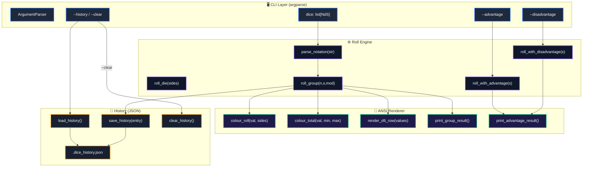
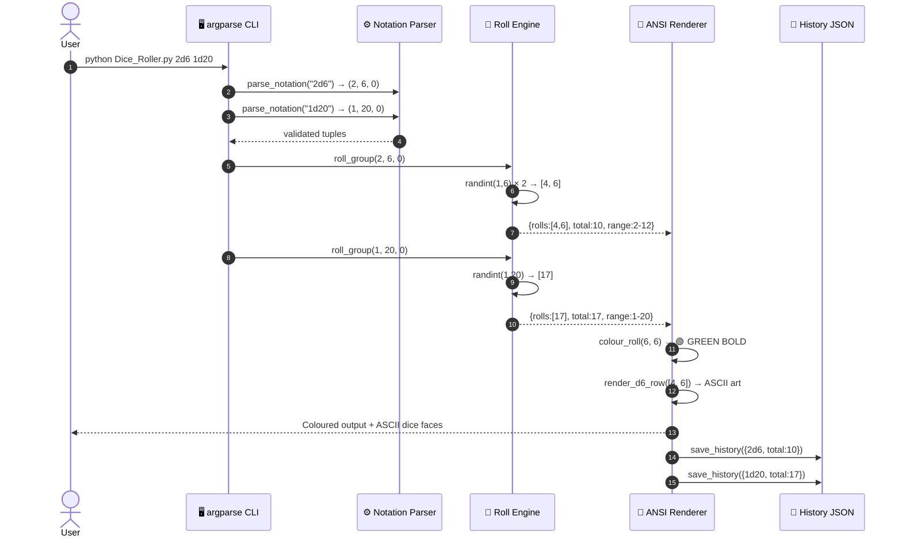
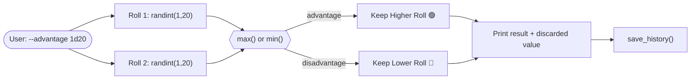

<div align="center">

# 🎲 3D Dice Roller & RPG Roll Engine
### *Zero-Dependency Python Standard Library • NdS Notation Parser • ASCII Die Art • Advantage/Disadvantage Mode • Persistent History*


-brightgreen.svg?style=for-the-badge)


<p align="center">
  <b>A fully-featured, standard-library-only Dice Roller CLI supporting standard RPG notation (NdS±M),
  multi-group rolls, ASCII d6 face art, colour-coded results, advantage/disadvantage mode,
  and persistent JSON roll history. From a single d6 to a 100d100 barrage — rolled in one command.</b>
</p>

</div>

---

## 🧊 3D Layered Architecture & Isometric Pipeline

```
                        +---------------------------------------------------------------+
                       /                                                               /|
                      /           [🖥️ LAYER 1: CLI PRESENTATION CUBE]                 / |
                     /   argparse • NdS Notation Tokens • Flags & Modes Engine       /  |
                    +---------------------------------------------------------------+   +
                    |                                                               |  /|
                    |  dice [NdS ...]   →  multi-group notation list               | / |
                    |  --advantage      →  roll twice, take max                    |/  |
                    |  --disadvantage   →  roll twice, take min                    |   +
                    |  --history        →  read .dice_history.json                 |  /
                    |  --clear-history  →  unlink history file                     | /
                    +---------------------------------------------------------------+/
                                                |
                                                v
                        +---------------------------------------------------------------+
                       /                                                               /|
                      /        [⚙️ LAYER 2: NOTATION PARSER & ROLL ENGINE CUBE]        / |
                     /   regex NdS±M • random.randint • modifier arithmetic          /  |
                    +---------------------------------------------------------------+   +
                    |                                                               |  /|
                    |  parse_notation("3d8+2") → (3, 8, +2)                        | / |
                    |  roll_die(sides)         → random.randint(1, sides)           |/  |
                    |  roll_group(n, s, mod)   → {rolls, subtotal, total, range}    |   +
                    |  roll_with_advantage(s)  → roll × 2, keep max                |  /
                    |  roll_with_disadvantage  → roll × 2, keep min                | /
                    +---------------------------------------------------------------+/
                                                |
                                                v
                        +---------------------------------------------------------------+
                       /                                                               /|
                      /      [🎨 LAYER 3: ANSI COLOUR RENDER & ASCII ART CUBE]         / |
                     /   colour_roll • colour_total • D6_FACES • textwrap            /  |
                    +---------------------------------------------------------------+   +
                    |                                                               |  /|
                    |  Roll = 1 (min)   →  🔴 RED   BOLD                           | / |
                    |  Roll = max       →  🟢 GREEN BOLD                            |/  |
                    |  Roll = mid-range →  🟡 YELLOW                               |   +
                    |  Total ≤ 25%      →  🔴 RED   | Total ≥ 85% → 🟢 GREEN       |  /
                    |  d6 ≤ 6 dice      →  ASCII face art rendered side-by-side    | /
                    +---------------------------------------------------------------+/
                                                |
                                                v
                        +---------------------------------------------------------------+
                       /                                                               /|
                      /         [💾 LAYER 4: PERSISTENT HISTORY JSON CUBE]             / |
                     /     .dice_history.json • Last 50 entries • Optional           /  |
                    +---------------------------------------------------------------+   +
                    |                                                               |  /
                    |  save_history({timestamp, notation, total})                  | /
                    |  load_history() → list[dict]  (graceful on corrupt/missing)  |/
                    |  clear_history() → Path.unlink()                             |
                    +---------------------------------------------------------------+
```

---

## 📐 3D Probability Space & Roll Geometry

Each die roll is a **discrete uniform random variable** $X \sim \mathcal{U}\{1, s\}$ where $s$ = number of sides:

```
     Probability
     ▲   P(X=k) = 1/s  for all k ∈ {1, 2, …, s}
     │
  1/s┤  ┌──┐ ┌──┐ ┌──┐ ┌──┐ ┌──┐ ┌──┐    d6: each face = 1/6 ≈ 16.7%
     │  │  │ │  │ │  │ │  │ │  │ │  │
     └──┴──┴─┴──┴─┴──┴─┴──┴─┴──┴─┴──┴──► Face value
        1   2   3   4   5   6
```

### Mathematical Foundations

#### 1. Expected Value of a Single Die

$$E[X] = \frac{s + 1}{2}$$

For a **d6**: $E[X] = \frac{7}{2} = 3.5$ &nbsp;|&nbsp; For a **d20**: $E[X] = 10.5$

#### 2. Sum of N Dice + Modifier

$$T = \sum_{i=1}^{n} X_i + M \quad \text{where } X_i \sim \mathcal{U}\{1, s\}$$

$$E[T] = n \cdot \frac{s+1}{2} + M \qquad \text{Var}[T] = n \cdot \frac{s^2 - 1}{12}$$

#### 3. Advantage: Roll Twice, Keep Max

$$E[X_{\max}] = E[\max(X_1, X_2)] = \frac{2s^2 + 2s - 1}{3s} \cdot \frac{s+1}{2s+2}$$

For a **d20** with advantage: $E[X_{\max}] \approx 13.83$ vs $10.5$ normally — a +3.33 effective bonus.

#### 4. Colour Thresholds

The result colour uses a **percentile position** $p$ within the roll's possible range $[n+M,\; n \cdot s + M]$:

$$p = \frac{T - T_{\min}}{T_{\max} - T_{\min}} \in [0, 1]$$

$$\text{Colour} = \begin{cases} \text{🔴 RED} & p \leq 0.25 \\ \text{🟢 GREEN} & p \geq 0.85 \\ \text{🔵 CYAN} & \text{otherwise} \end{cases}$$

---

## 🌟 Visual System Architecture (Mermaid)

### 1. Component Architecture



---

### 2. Roll Sequence Diagram



---

### 3. Advantage/Disadvantage Flow



---

## 🎨 Rich Terminal UI Mockups

### 1. Classic 2d6 Roll with ASCII Art

```text
$ python Dice_Roller.py 2d6

════════════════════════════════════════════════════════════
  🎲  2d6
════════════════════════════════════════════════════════════

  2d6
  Rolls    : [4 + 6]
  Total    : 10
  Range    : 2 – 12

┌───────┐  ┌───────┐
│ ●   ● │  │ ●   ● │
│       │  │ ●   ● │
│ ●   ● │  │ ●   ● │
└───────┘  └───────┘
```

### 2. Critical Hit — d20 Max Roll

```text
$ python Dice_Roller.py 1d20

════════════════════════════════════════════════════════════
  🎲  1d20
════════════════════════════════════════════════════════════

  1d20
  Rolls    : [20]
  Total    : 20   ← 🟢 GREEN BOLD (maximum!)
  Range    : 1 – 20
```

### 3. Critical Fail — Min Roll

```text
$ python Dice_Roller.py 1d20

  Rolls    : [1]
  Total    : 1    ← 🔴 RED BOLD (minimum!)
  Range    : 1 – 20
```

### 4. Multi-Group Roll with Grand Total

```text
$ python Dice_Roller.py 3d8+2 2d4

════════════════════════════════════════════════════════════
  🎲  3d8+2  ·  2d4
════════════════════════════════════════════════════════════

  3d8+2
  Rolls    : [7 + 3 + 5]
  Subtotal : 15
  Modifier : +2
  Total    : 17
  Range    : 5 – 26

  2d4
  Rolls    : [3 + 4]
  Subtotal : 7
  Total    : 7
  Range    : 2 – 8

  ────────────────────────────────────────
  Grand Total : 24
  Range       : 7 – 34
```

### 5. Advantage Roll — d20

```text
$ python Dice_Roller.py --advantage 1d20

════════════════════════════════════════════════════════════
  🎲  1d20 — Advantage
════════════════════════════════════════════════════════════

  1d20 with Advantage
  Rolled   : [14]  [9]
  ⬆️  Kept : 14   (discarded: 9)
```

### 6. Roll History View

```text
$ python Dice_Roller.py --history

════════════════════════════════════════════════════════════
  🎲  Roll History
════════════════════════════════════════════════════════════

  Timestamp              Notation        Result
  ──────────────────────────────────────────────────
  2026-11-14 23:19:42    2d6                 10
  2026-11-14 23:20:11    1d20                17
  2026-11-14 23:21:05    3d8+2               17
  2026-11-14 23:21:05    2d4                  7
  2026-11-14 23:22:30    1d20(adv)           14
```

### 7. ASCII d6 Faces Reference

```text
┌───────┐  ┌───────┐  ┌───────┐  ┌───────┐  ┌───────┐  ┌───────┐
│       │  │ ●     │  │ ●     │  │ ●   ● │  │ ●   ● │  │ ●   ● │
│   ●   │  │       │  │   ●   │  │       │  │   ●   │  │ ●   ● │
│       │  │     ● │  │     ● │  │ ●   ● │  │ ●   ● │  │ ●   ● │
└───────┘  └───────┘  └───────┘  └───────┘  └───────┘  └───────┘
    1          2          3          4          5          6
```

---

## ✨ Feature Overview

### 1. 🎲 Standard RPG Dice Notation
Supports the universal tabletop notation **NdS±M**:

| Notation | Meaning |
|---|---|
| `1d6` | Roll one 6-sided die |
| `2d6` | Roll two 6-sided dice, sum them |
| `1d20` | Roll one 20-sided die |
| `4d8+5` | Roll four 8-sided dice, add 5 |
| `3d6-2` | Roll three 6-sided dice, subtract 2 |
| `1d100` | Percentile roll |

### 2. 🎯 Multi-Group Rolls
Pass multiple notations to roll them all in one command and get a **grand total**:
```bash
python Dice_Roller.py 3d8+2 2d4 1d6
```

### 3. ⚔️ Advantage & Disadvantage
D&D 5e-style mechanics — roll the die twice:
- **`--advantage`**: keep the **higher** result (favourable conditions)
- **`--disadvantage`**: keep the **lower** result (unfavourable conditions)

### 4. 🎨 Colour-Coded Results
Every roll and total is colour-coded by its percentile within the possible range:

| Colour | Condition |
|---|---|
| 🔴 **Red** | Roll = 1 (minimum) or total ≤ 25th percentile |
| 🟢 **Green** | Roll = max (critical hit!) or total ≥ 85th percentile |
| 🟡 **Yellow** | Individual mid-range rolls |
| 🔵 **Cyan** | Mid-range totals |

### 5. 🎲 ASCII d6 Art
When rolling d6 dice (1–6 dice), the faces are rendered as ASCII art side-by-side automatically.

### 6. 📜 Persistent History
Every roll is logged to `.dice_history.json` (last 50 entries). View with `--history`, wipe with `--clear-history`. History failures never crash the app.

---

## 💻 Complete Command Reference

| Command | Description | Example |
|:---|:---|:---|
| `python Dice_Roller.py` | Roll 1d6 (default) | `python Dice_Roller.py` |
| `NdS` | Roll N dice with S sides | `python Dice_Roller.py 2d6` |
| `NdS+M` | Roll with modifier | `python Dice_Roller.py 3d8+2` |
| `NdS NdS …` | Multi-group roll | `python Dice_Roller.py 2d6 1d20` |
| `--advantage NdS` | Roll twice, keep highest | `python Dice_Roller.py --advantage 1d20` |
| `--disadvantage NdS` | Roll twice, keep lowest | `python Dice_Roller.py --disadvantage 1d20` |
| `--history` | Show last 10 rolls | `python Dice_Roller.py --history` |
| `--clear-history` | Wipe roll history | `python Dice_Roller.py --clear-history` |
| `--no-colour` | Disable ANSI colours | `python Dice_Roller.py --no-colour 2d6` |
| `--help` | Show usage & examples | `python Dice_Roller.py --help` |

---

## 🛡️ Error Handling

| Scenario | Trigger | Exit Code | Message |
|:---|:---|:---:|:---|
| **Bad notation** | `abc` / `d6` / `2x6` | `1` | `Error: Invalid dice notation 'abc'. Expected format: NdS` |
| **Zero dice** | `0d6` | `1` | `Error: Number of dice must be at least 1.` |
| **Too many dice** | `101d6` | `1` | `Error: Maximum 100 dice per group.` |
| **1-sided die** | `2d1` | `1` | `Error: A die must have at least 2 sides.` |
| **Sides too large** | `1d99999` | `1` | `Error: Maximum 10000 sides per die.` |

---

## 🚀 Setup & Usage

No installation required — zero external dependencies.

```bash
# Basic rolls
python Dice_Roller.py                   # 1d6
python Dice_Roller.py 1d20              # 20-sided die
python Dice_Roller.py 2d6               # two d6 with ASCII art
python Dice_Roller.py 4d8+5             # RPG damage roll with modifier

# Multi-group
python Dice_Roller.py 3d6 1d4 2d8

# D&D Advantage/Disadvantage
python Dice_Roller.py --advantage 1d20
python Dice_Roller.py --disadvantage 1d20

# History
python Dice_Roller.py --history
python Dice_Roller.py --clear-history

# No colour (e.g. for piping output)
python Dice_Roller.py --no-colour 3d6
```

---

## 📁 Project Structure

```
50 Mini Projects/
├── Dice_Roller.py              ← Main application (single file, stdlib only)
│   ├── D6_FACES (dict)         ← ASCII art for d6 faces 1–6
│   ├── parse_notation(str)     ← Regex NdS±M → (count, sides, mod)
│   ├── roll_die(sides)         ← random.randint(1, sides)
│   ├── roll_group(n, s, mod)   ← Roll N dice, return full result dict
│   ├── roll_with_advantage(s)  ← Roll twice, keep max
│   ├── roll_with_disadvantage  ← Roll twice, keep min
│   ├── render_d6_row(values)   ← Side-by-side ASCII d6 art
│   ├── colour_roll(val, sides) ← ANSI colour per roll position
│   ├── colour_total(v,min,max) ← ANSI colour per percentile
│   ├── print_group_result()    ← Full formatted group output
│   ├── print_advantage_result()← Advantage/disadvantage output
│   ├── print_summary()         ← Grand total across groups
│   ├── load/save/clear_history ← JSON history management
│   ├── build_parser()          ← argparse CLI definition
│   └── main()                  ← Entry point (exit code 0/1)
└── .dice_history.json          ← Auto-created roll history (last 50)
```

---

## 📜 Complete Terminal Demo

```bash
# 1. Default roll — 1d6
$ python Dice_Roller.py
  🎲  1d6
  Rolls    : [3]
  Total    : 3
  Range    : 1 – 6

┌───────┐
│ ●     │
│   ●   │
│     ● │
└───────┘

# 2. Classic 2d6
$ python Dice_Roller.py 2d6
  🎲  2d6
  Rolls    : [6 + 1]
  Subtotal : 7
  Total    : 7
  Range    : 2 – 12

┌───────┐  ┌───────┐
│ ●   ● │  │       │
│ ●   ● │  │   ●   │
│ ●   ● │  │       │
└───────┘  └───────┘

# 3. RPG attack roll with modifier
$ python Dice_Roller.py 3d8+2
  🎲  3d8+2
  Rolls    : [7 + 3 + 8]
  Subtotal : 18
  Modifier : +2
  Total    : 20
  Range    : 5 – 26

# 4. D&D Advantage
$ python Dice_Roller.py --advantage 1d20
  🎲  1d20 — Advantage
  1d20 with Advantage
  Rolled   : [14]  [9]
  ⬆️  Kept : 14   (discarded: 9)

# 5. Disadvantage
$ python Dice_Roller.py --disadvantage 1d20
  Rolled   : [5]  [18]
  ⬇️  Kept : 5    (discarded: 18)

# 6. Multi-group — full character damage
$ python Dice_Roller.py 2d6 1d8 1d4+3
  Grand Total : 21
  Range       : 6 – 32

# 7. Percentile roll
$ python Dice_Roller.py 1d100
  Rolls    : [73]
  Total    : 73
  Range    : 1 – 100

# 8. View history
$ python Dice_Roller.py --history
  Timestamp              Notation        Result
  2026-11-14 23:19:42    2d6                  7
  2026-11-14 23:20:11    1d20                14
  2026-11-14 23:21:30    3d8+2               20

# 9. Clear history
$ python Dice_Roller.py --clear-history
🗑️  Dice roll history cleared.
```

---

## 🧩 Design Decisions

| Decision | Rationale |
|:---|:---|
| **`random.randint(1, s)`** | The core two lines — everything else is UI around them |
| **Regex `NdS±M` parser** | Handles the full RPG standard notation including modifiers |
| **`D6_FACES` dict** | d6 is the most common die; ASCII art rewards the most popular roll |
| **Percentile colour-coding** | Makes the "feel" of a roll immediately obvious at a glance |
| **`--no-colour` flag** | Keeps output pipe-friendly for scripts and log redirection |
| **History never crashes** | `save_history` silently swallows `OSError` — history is a bonus, not core |
| **`MAX_DICE = 100`** | Guards against `100000d6` hanging the terminal for a minute |
| **`raise SystemExit(main())`** | Propagates exit codes correctly on all platforms |

