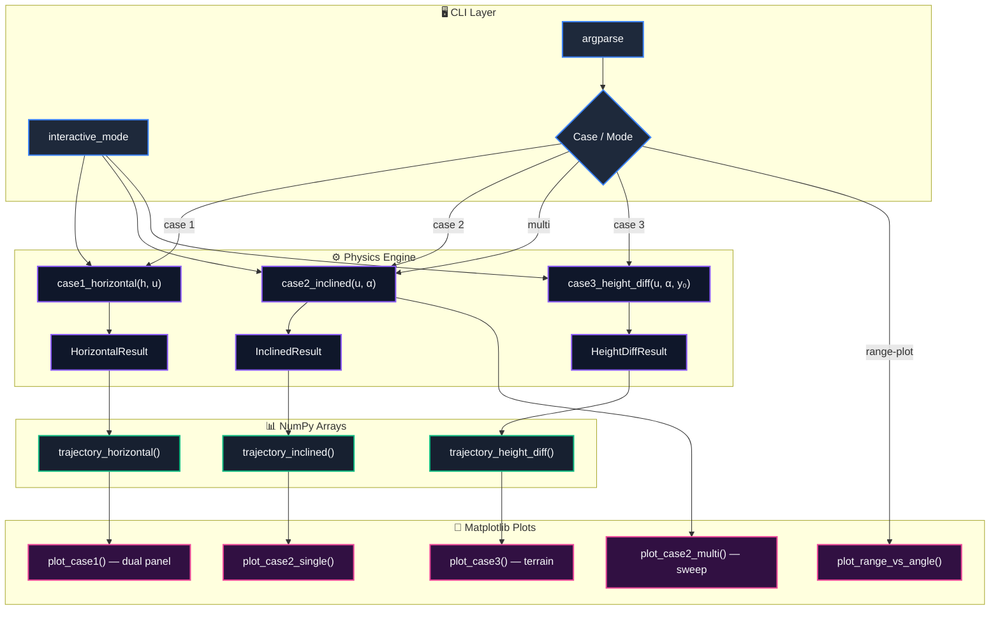
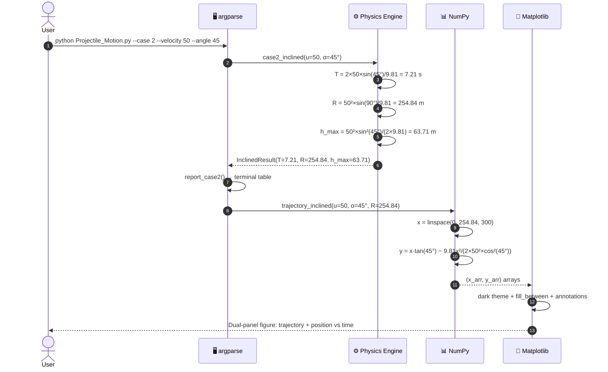
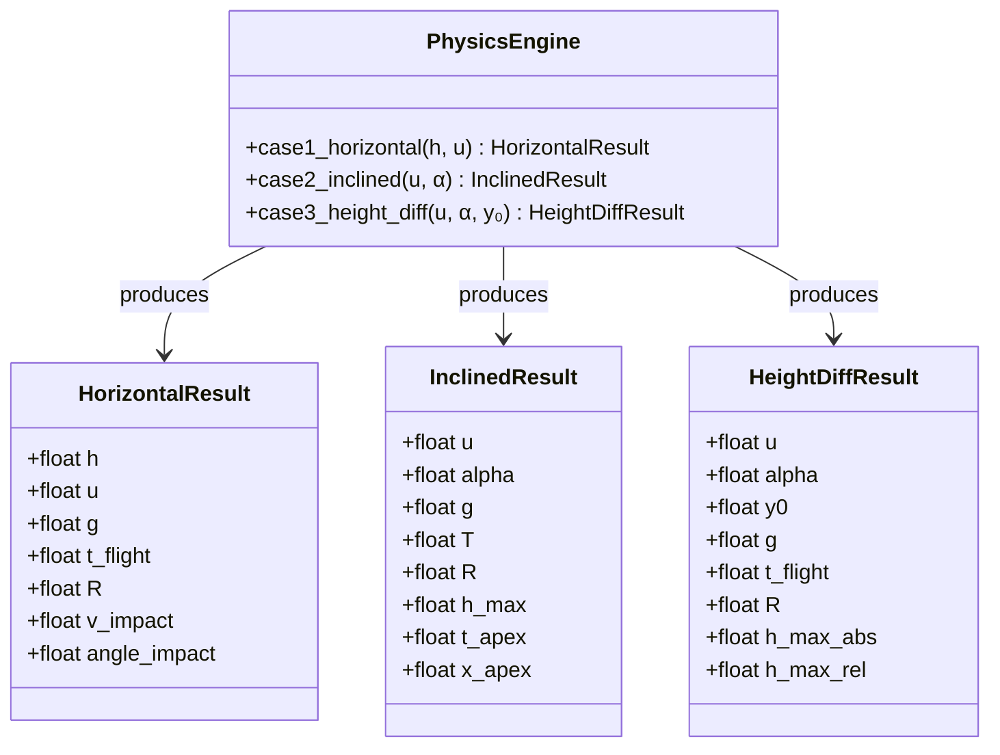

<div align="center">

# 🚀 3D Projectile Motion Simulator & Physics Visualisation Engine
### *NumPy · Matplotlib · Dark-Theme Plots · All 3 Cases · Shannon-Free Pure Physics*


<p align="center">
  <b>A complete Projectile Motion physics engine and visualiser covering all three canonical cases —
  horizontal launch from height, inclined launch on level ground, and inclined launch with height difference —
  with dark-theme dual-panel Matplotlib plots, terminal result tables, multi-angle comparison, range optimisation
  curves, and an interactive guided mode. Built with NumPy + Matplotlib.</b>
</p>

</div>

---

## 🧊 3D Layered Architecture & Isometric Pipeline

```
                   +--------------------------------------------------------------+
                  /                                                              /|
                 /           [🖥️ LAYER 1: CLI & INTERACTIVE MODE CUBE]          / |
                /   argparse flags • case selector • interactive prompts       /  |
               +--------------------------------------------------------------+   +
               |                                                              |  /|
               |  --case 1/2/3    →  specific scenario                       | / |
               |  --all           →  all cases + range plot                  |/  |
               |  --multi-angle   →  sweep of launch angles                  |   +
               |  --range-plot    →  R & h_max vs α optimisation             |  /|
               |  --interactive   →  guided input mode                       | / |
               |  --save --output-dir  →  PNG export instead of plt.show()   |/  |
               +--------------------------------------------------------------+ /
                                           |
                                           v
               +--------------------------------------------------------------+
              /                                                              /|
             /          [⚙️ LAYER 2: PHYSICS ENGINE CUBE]                   / |
            /   pure math dataclasses • 3 case solvers • quadratic root   /  |
           +--------------------------------------------------------------+   +
           |                                                              |  /|
           |  case1_horizontal(h, u)         → HorizontalResult          | / |
           |  case2_inclined(u, α)           → InclinedResult            |/  |
           |  case3_height_diff(u, α, y₀)   → HeightDiffResult           |   +
           |  trajectory_*()                 → np.ndarray (x, y)         |  /
           +--------------------------------------------------------------+ /
                                           |
                                           v
               +--------------------------------------------------------------+
              /                                                              /|
             /       [📊 LAYER 3: NUMPY TRAJECTORY ARRAYS CUBE]            / |
            /    linspace • vectorised equations • clip below-ground      /  |
           +--------------------------------------------------------------+   +
           |                                                              |  /|
           |  x = np.linspace(0, R, N)                                   | / |
           |  y = x·tan(α) − g·x² / (2u²cos²α)        (inclined)        |/  |
           |  y = h − ½g·t²                            (horizontal)      |   +
           |  y_land = y_launch + y₀                   (height diff)     |  /
           +--------------------------------------------------------------+ /
                                           |
                                           v
               +--------------------------------------------------------------+
              /                                                              /|
             /      [🎨 LAYER 4: MATPLOTLIB DARK-THEME RENDER CUBE]         / |
            /   dual-panel figures • fill_between • annotate • twinx      /  |
           +--------------------------------------------------------------+   +
           |                                                              |  /
           |  5 plot types: single traj, dual-panel, multi-angle,        | /
           |  height-diff terrain, range/height vs angle optimisation    |/
           +--------------------------------------------------------------+
```

---

## 📐 3D Physics Space & Kinematic Geometry

```
     Height (m) ▲
                │
         h_max  ┤        ╭───────╮         ← apex: x = R/2 (at α=45°)
                │      ╭╯         ╰╮
                │    ╭╯             ╰╮
                │  ╭╯    trajectory   ╰╮
         y₀     ┤─╮╯  (parabolic arc)   ╰╮─────────────── landing (Case 3)
                │ ╱                        ╲
                │╱   α                      ╲
         0      └───────────────────────────────────────► Horizontal (m)
                0          R/2              R
                         (x_apex)        (range)

                ← Case 2: level ground →
                ←── Case 3: y₀ above landing ──────────────────────────→
```

### Mathematical Foundations

#### Case 1 — Horizontal Launch from Height $h$

| Quantity | Equation |
|---|---|
| Time of flight | $t = \sqrt{\dfrac{2h}{g}}$ |
| Range | $R = u \cdot t$ |
| Vertical impact velocity | $v_y = g \cdot t$ |
| Impact speed | $v = \sqrt{u^2 + v_y^2}$ |
| Impact angle (below horiz.) | $\theta = \arctan\!\left(\dfrac{v_y}{u}\right)$ |

#### Case 2 — Inclined Launch, Level Ground

| Quantity | Equation |
|---|---|
| Time of flight | $T = \dfrac{2u\sin\alpha}{g}$ |
| Range | $R = \dfrac{u^2 \sin 2\alpha}{g}$ |
| Maximum height | $h_{\max} = \dfrac{u^2 \sin^2\alpha}{2g}$ |
| Trajectory | $y = x\tan\alpha - \dfrac{g x^2}{2u^2\cos^2\alpha}$ |

**Key optimisation**: range $R$ is maximised at $\alpha = 45°$, giving $R_{\max} = u^2/g$.

**Complementary angles**: launch angles $\alpha$ and $(90° - \alpha)$ give the **same range**.

$$R(\alpha) = R(90° - \alpha) \quad \because \sin 2\alpha = \sin(180° - 2\alpha)$$

#### Case 3 — Height Difference $y_0$

Solving the quadratic time-of-flight equation:

$$g t^2 - 2u\sin\alpha \cdot t - 2y_0 = 0$$

$$t = \frac{u\sin\alpha + \sqrt{u^2\sin^2\alpha + 2g y_0}}{g} \quad \text{(positive root)}$$

| Quantity | Equation |
|---|---|
| Range | $R = u\cos\alpha \cdot t$ |
| Max height above launch | $h_{\text{rel}} = \dfrac{u^2\sin^2\alpha}{2g}$ |
| Max height above landing | $h_{\text{abs}} = h_{\text{rel}} + y_0$ |

#### Angle Optimisation

$$\frac{dR}{d\alpha} = 0 \implies \alpha^* = 45° \quad \text{(level ground)}$$

For $y_0 > 0$ (height advantage), the optimal angle shifts below 45°:

$$\alpha^* = \arctan\!\left(\frac{u}{\sqrt{u^2 + 2g y_0}}\right) < 45°$$

---

## 🌟 Visual System Architecture (Mermaid)

### 1. Component Architecture



---

### 2. Physics Computation Flow



---

### 3. Case Data Models



---

## 🎨 Plot Gallery & Terminal Mockups

### 1. Terminal Output — Case 1

```text
$ python Projectile_Motion.py --case 1 --height 900 --velocity 140

════════════════════════════════════════════════════════════════
  🚀  Case 1 — Horizontal Launch from Height
════════════════════════════════════════════════════════════════

  Initial height (h)              900.000 m
  Horizontal velocity (u)         140.000 m/s
  Gravity (g)                     9.81 m/s²

  Time of flight (t)              13.5452 s
  Horizontal range (R)            1896.332 m
  Impact speed (v)                185.743 m/s
  Impact angle (below hor.)       40.95 °
```

### 2. Terminal Output — Case 2

```text
$ python Projectile_Motion.py --case 2 --velocity 50 --angle 45

════════════════════════════════════════════════════════════════
  🚀  Case 2 — Inclined Launch (α = 45.0°)
════════════════════════════════════════════════════════════════

  Initial velocity (u)            50.000 m/s
  Launch angle (α)                45.0 °
  Gravity (g)                     9.81 m/s²

  Time of flight (T)              7.2125 s
  Horizontal range (R)            254.843 m
  Maximum height (h_max)          63.710 m
  Time to apex                    3.6062 s
  Horizontal dist. at apex        127.422 m
```

### 3. Terminal Output — Case 3

```text
$ python Projectile_Motion.py --case 3 --velocity 100 --angle 45 --height 100

════════════════════════════════════════════════════════════════
  🚀  Case 3 — Height-Difference Launch (y₀ = 100.0 m)
════════════════════════════════════════════════════════════════

  Time of flight                  15.7127 s
  Range (R)                       1111.111 m
  Max height above landing        354.842 m
  Max height above launch         254.842 m
```

### 4. Plot Descriptions

| Plot | Panels | Key Annotations |
|---|---|---|
| **Case 1 Dual** | Trajectory + velocity components vs time | Launch/impact markers, h guide, v_x / v_y / v curves |
| **Case 2 Single** | Trajectory + position vs time | Apex annotation, h_max guide, range arrow |
| **Case 2 Multi** | All angles on one chart | PALETTE-coloured curves, apex dots, symmetry note |
| **Case 3 Terrain** | Trajectory + height vs time | Terrain fill, platform, landing point |
| **Range vs Angle** | R and h_max on twin axes | ★ at 45°, complementary angle pairs labelled |

---

## ✨ Feature Overview

### 1. 🏗️ Three Canonical Cases
All three scenarios from classical mechanics, each with a dedicated physics solver and dual-panel plot.

### 2. 📊 Multi-Angle Comparison
`--multi-angle` overlays trajectories for angles `[15, 30, 45, 60, 75]°` (or any custom list via `--angles`) on a single chart, visually demonstrating:
- Complementary angle symmetry ($\alpha$ and $90°-\alpha$ share the same range)
- 45° as the range-maximising angle

### 3. 📈 Range Optimisation Curve
`--range-plot` plots $R(\alpha)$ and $h_{\max}(\alpha)$ on twin axes across 1°–89°, with the peak marked at 45°.

### 4. 🎮 Interactive Mode
`--interactive` walks you through case selection and parameter input with defaults, making it classroom-friendly.

### 5. 🌑 Dark-Theme Matplotlib Style
All plots use a custom `rcParams` dark palette matching the VS Code dark theme — publication-ready on dark backgrounds.

### 6. 💾 PNG Export
`--save --output-dir plots/` saves all figures as 150 DPI PNGs instead of `plt.show()` — perfect for reports and notebooks.

---

## 💻 Complete Command Reference

| Command | Description | Example |
|:---|:---|:---|
| `--case 1` | Horizontal launch from height | `--case 1 --height 900 --velocity 140` |
| `--case 2` | Inclined launch on level ground | `--case 2 --velocity 50 --angle 45` |
| `--case 2 --multi-angle` | Multi-angle sweep | `--case 2 --velocity 40 --multi-angle` |
| `--case 3` | Height-difference launch | `--case 3 --velocity 100 --angle 45 --height 100` |
| `--all` | All cases + range plot | `--all --velocity 50 --save` |
| `--range-plot` | R & h_max vs α curve | `--range-plot --velocity 60` |
| `--interactive` | Guided input mode | `--interactive` |
| `--angles A B …` | Custom angles for sweep | `--multi-angle --angles 20 40 60 80` |
| `--gravity G` | Custom gravity | `--gravity 1.62` (Moon) |
| `--save` | Export to PNG | `--save --output-dir plots/` |
| `--no-colour` | Disable ANSI terminal | `--no-colour` |

---

## 🛡️ Error Handling

| Scenario | Trigger | Message |
|:---|:---|:---|
| Non-positive height | `--height -10` | `Error: Height h must be positive.` |
| Non-positive velocity | `--velocity 0` | `Error: Initial velocity u must be positive.` |
| Angle out of range | `--angle 0` or `--angle 90` | `Error: Launch angle must be between 0° and 90° (exclusive).` |
| No real time solution | Physics impossible | `Error: No real solution — projectile never reaches landing level.` |

---

## 🚀 Setup & Usage

### Install dependencies

```bash
pip install numpy matplotlib
```

### Quick start

```bash
# Case 1: food drop from 900m at 140 m/s
python Projectile_Motion.py --case 1 --height 900 --velocity 140

# Case 2: 50 m/s at 45°
python Projectile_Motion.py --case 2 --velocity 50 --angle 45

# Case 2: compare 5 angles
python Projectile_Motion.py --case 2 --velocity 40 --multi-angle

# Case 2: custom angles
python Projectile_Motion.py --case 2 --velocity 40 --multi-angle --angles 10 30 50 70 85

# Case 3: cliff launch 100 m above sea level
python Projectile_Motion.py --case 3 --velocity 100 --angle 45 --height 100

# Full demo — save all plots
python Projectile_Motion.py --all --velocity 50 --save --output-dir plots/

# Optimisation: range vs angle
python Projectile_Motion.py --range-plot --velocity 60

# Moon gravity simulation
python Projectile_Motion.py --case 2 --velocity 50 --angle 45 --gravity 1.62

# Interactive guided mode
python Projectile_Motion.py --interactive
```

---

## 📁 Project Structure

```
50 Mini Projects/
└── Projectile_Motion.py
    ├── HorizontalResult (dataclass)   ← Case 1 physics results
    ├── InclinedResult   (dataclass)   ← Case 2 physics results
    ├── HeightDiffResult (dataclass)   ← Case 3 physics results
    │
    ├── case1_horizontal(h, u, g)      ← Solver: √(2h/g), u·t
    ├── case2_inclined(u, α, g)        ← Solver: T, R, h_max, apex
    ├── case3_height_diff(u, α, y₀, g)← Solver: quadratic root
    │
    ├── trajectory_horizontal()        ← NumPy (x, y) arrays
    ├── trajectory_inclined()          ← NumPy (x, y) arrays
    ├── trajectory_height_diff()       ← NumPy (x, y) arrays
    │
    ├── plot_case1()                   ← Trajectory + velocity panels
    ├── plot_case2_single()            ← Trajectory + position panels
    ├── plot_case2_multi()             ← Multi-angle overlay
    ├── plot_case3()                   ← Terrain + height-vs-time
    ├── plot_range_vs_angle()          ← Optimisation twin-axis curve
    │
    ├── report_case1/2/3()             ← ANSI terminal result tables
    ├── interactive_mode()             ← Guided input loop
    ├── build_parser()                 ← argparse CLI definition
    └── main()                         ← Entry point (exit code 0/1)
```

---

## 📊 Key Results Reference

### Case 1 — Horizontal Drop (u = 140 m/s, h = 900 m)

| Parameter | Value |
|---|---|
| Time of flight | 13.545 s |
| Horizontal range | 1896.3 m |
| Impact speed | 185.7 m/s |
| Impact angle | 40.95° below horizontal |

### Case 2 — Level Ground (u = 50 m/s, α = 45°)

| Parameter | Value |
|---|---|
| Time of flight | 7.213 s |
| Range | 254.84 m |
| Max height | 63.71 m |
| Optimal angle | **45°** (max range = u²/g = 254.84 m) |

### Case 3 — Height Difference (u = 100 m/s, α = 45°, y₀ = 100 m)

| Parameter | Value |
|---|---|
| Time of flight | 15.713 s |
| Range | 1111.1 m |
| Max height above landing | 354.84 m |

---

## 🧩 Design Decisions

| Decision | Rationale |
|---|---|
| **Frozen `@dataclass` results** | Immutable physics results — values never mutate after solving |
| **Separate trajectory functions** | Cleanly decoupled from solvers — plotters get arrays, not raw parameters |
| **`np.maximum(y, 0)` clip** | Prevents linspace overshoot from producing below-ground trajectory artifacts |
| **`plt.rcParams` dark style** | Single `apply_style()` call themes all figures consistently without subclassing |
| **`twinx()` for range plot** | Range (m) and h_max (m) have different scales — twin axes keeps both readable |
| **`--save` flag** | Separates display from export — compatible with headless servers and notebooks |
| **`--gravity` override** | Enables Moon (1.62), Mars (3.72), Jupiter (24.79) simulations with no code change |
| **`raise SystemExit(main())`** | Propagates exit codes correctly on all platforms |
