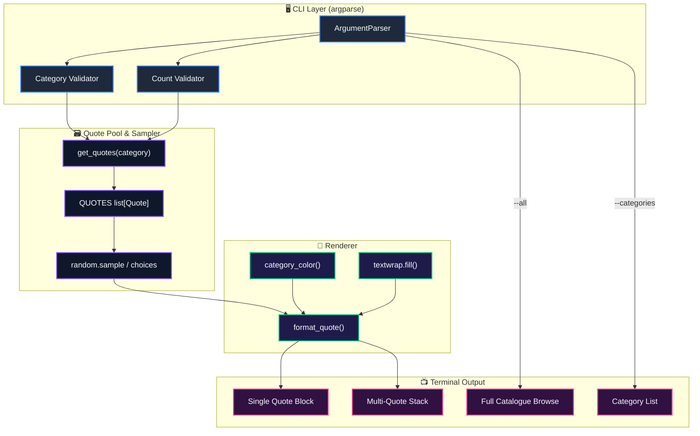
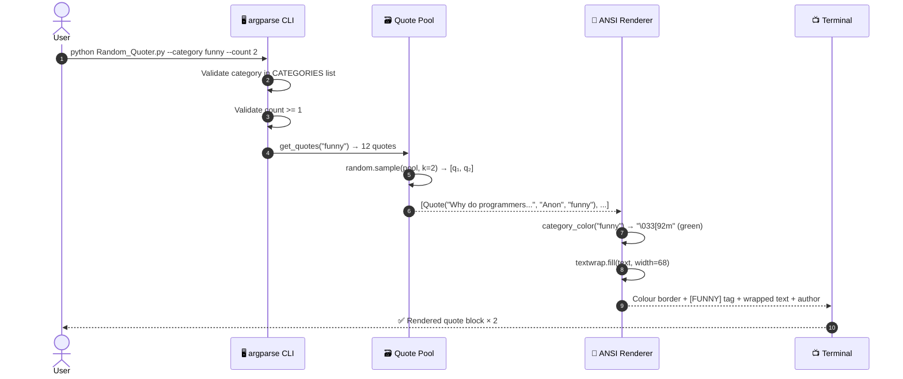
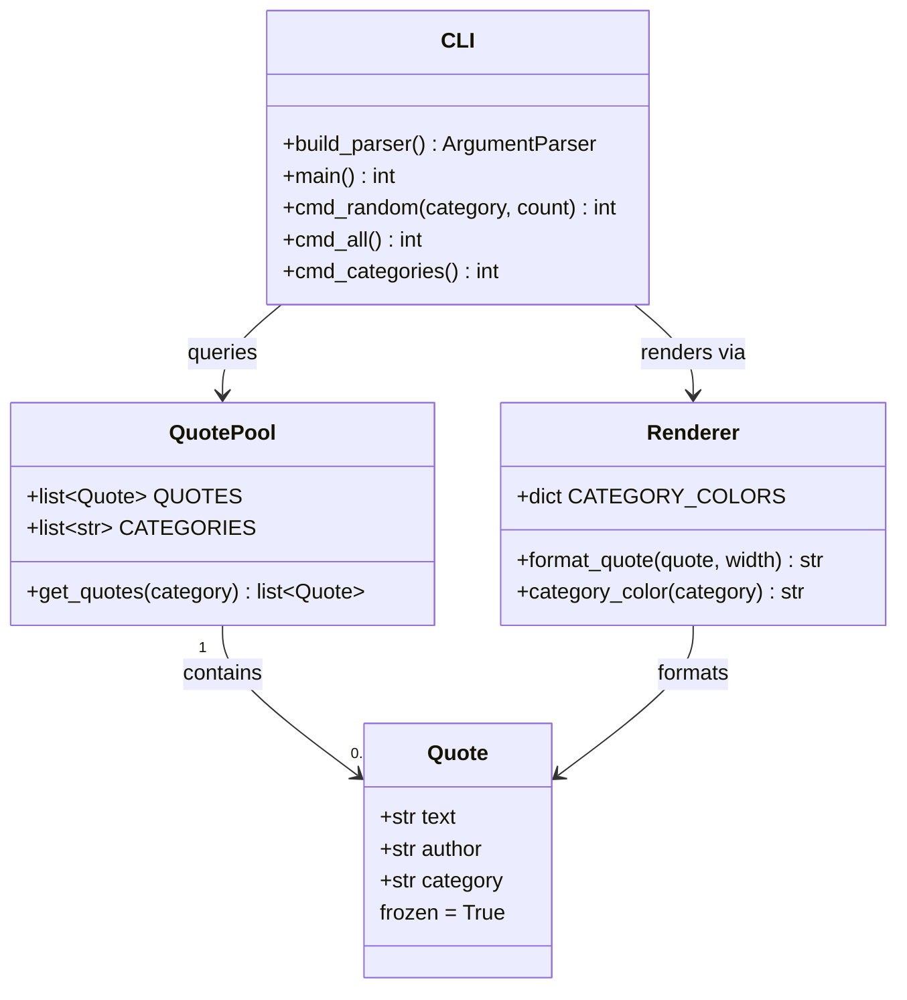

<div align="center">

# 🎲 3D Random Quote Generator & Wisdom Dispatch Engine
### *Zero-Dependency Python Standard Library • ANSI Colour Rendering • Category Intelligence • Word-Wrap Engine*


-brightgreen.svg?style=for-the-badge)


<p align="center">
  <b>A beautifully minimal, standard-library-only Quote Generator CLI that fires off curated wisdom —
  motivational, programming, funny, and philosophical — with ANSI colour-coded output, word-wrap,
  category filtering, and multi-quote sampling. Runs in one command.</b>
</p>

</div>

---

## 🧊 3D Layered Architecture & Isometric Pipeline

```
                           +----------------------------------------------------------+
                          /                                                            /|
                         /          [🖥️ LAYER 1: CLI PRESENTATION CUBE]               / |
                        /    argparse • Category Filter • Count Validation Engine    /  |
                       +----------------------------------------------------------+   +
                       |                                                          |  /|
                       |  --category  →  Pool Filter (funny | programming | …)   | / |
                       |  --count     →  Sample Size (1..N, no repeats)          |/  |
                       |  --all       →  Full Catalogue Browse Mode              |   +
                       |  --categories→  Genre Discovery Listing                 |  /
                       +----------------------------------------------------------+ /
                                                    |
                                                    v
                           +----------------------------------------------------------+
                          /                                                            /|
                         /       [🗃️ LAYER 2: QUOTE POOL & SAMPLING ENGINE CUBE]      / |
                        /   frozen dataclasses • random.sample • category index     /  |
                       +----------------------------------------------------------+   +
                       |                                                          |  /|
                       |  Quote(text, author, category)  — immutable + hashable   | / |
                       |  random.sample()  — no-repeat draws across pool          |/  |
                       |  random.choices() — overflow fallback if N > pool size   |   +
                       +----------------------------------------------------------+  /
                                                    |
                                                    v
                           +----------------------------------------------------------+
                          /                                                            /|
                         /      [🎨 LAYER 3: ANSI COLOUR RENDER & FORMAT CUBE]        / |
                        /   textwrap.fill • ANSI escape codes • 72-char columns     /  |
                       +----------------------------------------------------------+   +
                       |                                                          |  /
                       |  Category → Colour Map: motivational=🟡 funny=🟢        | /
                       |  textwrap.fill() → word-wrap at 72 chars (60 inner)     |/
                       |  BOLD / DIM / ITALIC ANSI sequences for visual depth    |
                       +----------------------------------------------------------+
```

---

## 📐 3D Probability Space & Random Sampling Geometry

The quote pool is modelled as a **discrete probability space** $(\Omega, \mathcal{F}, P)$:

```
     Category Axis (k genres)
     ▲
     │
     │  philosophy ──────────────────────●  8 quotes
     │                                  /
     │  motivational ────────────────● /   10 quotes
     │                              / /
     │  funny ──────────────────●  / /    12 quotes
     │                         /  / /
     │  programming ────────●  / / /     15 quotes
     │                      / / / /
     └──────────────────────/─/─/─/─────────────► Pool Index (0..44)
                           /  Total: 45 quotes
                          ▼
                     Sample Draw
              random.sample(pool, k=N)   ← no-repeat guarantee
              random.choices(pool, k=N)  ← only if N > |pool|
```

### Mathematical Foundations

#### 1. No-Repeat Sample Probability

For pool size $n$ and requested sample size $k \leq n$, the probability of drawing a specific ordered sequence without replacement:

$$P(\text{sequence}) = \frac{(n-k)!}{n!} = \frac{1}{n \cdot (n-1) \cdots (n-k+1)}$$

#### 2. Category Filter Reduction

Given full pool $\Omega$ and category predicate $c$, the filtered sub-pool is:

$$\Omega_c = \{ q \in \Omega \mid q.\text{category} = c \}$$

The uniform draw probability over the filtered pool:

$$P(q \mid c) = \frac{1}{|\Omega_c|}$$

#### 3. Overflow Sampling

When $k > |\Omega_c|$, the engine blends both strategies:

$$\text{sample} = \underbrace{\text{sample}(\Omega_c, |\Omega_c|)}_{\text{no-repeat prefix}} \cup \underbrace{\text{choices}(\Omega_c,\; k - |\Omega_c|)}_{\text{random overflow}}$$

---

## 🌟 Visual System Architecture (Mermaid)

### 1. Component Architecture



---

### 2. Quote Delivery Sequence



---

### 3. Data Model



---

## 🎨 Rich Terminal UI Mockups

### 1. Single Random Quote (default)

```text
┄┄┄┄┄┄┄┄┄┄┄┄┄┄┄┄┄┄┄┄┄┄┄┄┄┄┄┄┄┄┄┄┄┄┄┄┄┄┄┄┄┄┄┄┄┄┄┄┄┄┄┄┄┄┄┄┄┄┄┄┄┄┄┄┄┄┄┄┄┄┄┄
$ python Random_Quoter.py
┄┄┄┄┄┄┄┄┄┄┄┄┄┄┄┄┄┄┄┄┄┄┄┄┄┄┄┄┄┄┄┄┄┄┄┄┄┄┄┄┄┄┄┄┄┄┄┄┄┄┄┄┄┄┄┄┄┄┄┄┄┄┄┄┄┄┄┄┄┄┄┄

────────────────────────────────────────────────────────────────────────
  [PROGRAMMING]

  "Talk is cheap. Show me the code."

      — Linus Torvalds
────────────────────────────────────────────────────────────────────────
```

### 2. Multi-Quote Draw with Category Filter

```text
$ python Random_Quoter.py --category funny --count 3

────────────────────────────────────────────────────────────────────────
  [FUNNY]

  "Why do programmers prefer dark mode? Because light attracts
  bugs."

      — Anonymous
────────────────────────────────────────────────────────────────────────

────────────────────────────────────────────────────────────────────────
  [FUNNY]

  "There are 10 types of people in the world: those who
  understand binary, and those who don't."

      — Anonymous
────────────────────────────────────────────────────────────────────────

────────────────────────────────────────────────────────────────────────
  [FUNNY]

  "A SQL query walks into a bar, walks up to two tables and
  asks: 'Can I join you?'"

      — Anonymous
────────────────────────────────────────────────────────────────────────
```

### 3. Category Discovery View

```text
$ python Random_Quoter.py --categories

Available categories:

  ●  funny           12 quotes
  ●  motivational    10 quotes
  ●  philosophy       8 quotes
  ●  programming     15 quotes
```

### 4. Motivational Full-Width Block

```text
$ python Random_Quoter.py --category motivational

────────────────────────────────────────────────────────────────────────
  [MOTIVATIONAL]

  "The only way to do great work is to love what you do."

      — Steve Jobs
────────────────────────────────────────────────────────────────────────
```

### 5. Philosophy — Wide Quote Word-Wrap

```text
$ python Random_Quoter.py --category philosophy

────────────────────────────────────────────────────────────────────────
  [PHILOSOPHY]

  "Two things are infinite: the universe and human stupidity;
  and I'm not sure about the universe."

      — Albert Einstein
────────────────────────────────────────────────────────────────────────
```

---

## ✨ Feature Overview

### 1. 🎲 Smart Random Sampling
- Uses **`random.sample()`** for no-repeat draws — you never get the same quote twice in one `--count N` run (up to pool size).
- When `--count` exceeds the pool, overflows gracefully with `random.choices()`.

### 2. 🏷️ Category Intelligence
- **4 genres**: `programming`, `funny`, `motivational`, `philosophy`
- Filter with `--category` to stay in your mood.
- `--categories` lists every genre with its quote count at a glance.

### 3. 🎨 ANSI Colour-Coded Output
| Category | ANSI Colour | Code |
|---|---|---|
| `programming` | Cyan | `\033[96m` |
| `funny` | Green | `\033[92m` |
| `motivational` | Yellow | `\033[93m` |
| `philosophy` | Magenta | `\033[95m` |

### 4. 📐 Word-Wrap Engine
- `textwrap.fill()` wraps long quotes cleanly at **72 characters** with consistent indentation — no truncation, no overflow.

### 5. 📚 Full Catalogue Browse
- `--all` prints every quote grouped by category with section headers — great for copy-pasting your favourites.

### 6. 🧊 Frozen Dataclasses
- `Quote` objects use `@dataclass(frozen=True)` — immutable, hashable, and safe to store in sets or use as dict keys.

---

## 💻 Complete Command Reference

| Command | Flag | Description | Example |
|:---|:---|:---|:---|
| *(no flags)* | — | Print one random quote from any category | `python Random_Quoter.py` |
| `--count N` / `-n N` | optional | Print N quotes (no repeats up to pool size) | `python Random_Quoter.py -n 5` |
| `--category CAT` / `-c CAT` | optional | Filter to a specific genre | `python Random_Quoter.py -c programming` |
| `--all` / `-a` | optional | Print every quote grouped by category | `python Random_Quoter.py --all` |
| `--categories` | optional | List genres and their quote counts | `python Random_Quoter.py --categories` |
| `--help` / `-h` | optional | Show usage and examples | `python Random_Quoter.py --help` |

---

## 🛡️ Error Handling

| Scenario | Trigger | Exit Code | Message |
|:---|:---|:---:|:---|
| **Unknown category** | `--category xyz` | `2` | `error: unknown category 'xyz'. Choose from: funny, motivational, philosophy, programming` |
| **Count less than 1** | `--count 0` | `2` | `error: --count must be at least 1` |
| **Non-integer count** | `--count abc` | `2` | `error: argument --count: invalid int value: 'abc'` |

---

## 🚀 Setup & Usage

No installation required — zero external dependencies.

### Run directly

```bash
python Random_Quoter.py
```

### Category filter + multiple quotes

```bash
python Random_Quoter.py --category programming --count 3
python Random_Quoter.py --category funny -n 2
python Random_Quoter.py --category motivational
python Random_Quoter.py --category philosophy
```

### Browse everything

```bash
python Random_Quoter.py --all
python Random_Quoter.py --categories
```

### Help

```bash
python Random_Quoter.py --help
```

### Windows (PowerShell)

```powershell
python "Random_Quoter.py" --category programming
```

---

## 📁 Project Structure

```
50 Mini Projects/
└── Random_Quoter.py          ← Single-file application (stdlib only)
    ├── Quote (dataclass)     ← Immutable quote record
    ├── QUOTES (list)         ← 45 curated quotes across 4 categories
    ├── CATEGORIES (list)     ← Sorted unique category index
    ├── format_quote()        ← ANSI colour + word-wrap renderer
    ├── get_quotes()          ← Category filter helper
    ├── cmd_random()          ← Default: random N quotes
    ├── cmd_all()             ← Full catalogue browse
    ├── cmd_categories()      ← Genre listing
    ├── build_parser()        ← argparse CLI definition
    └── main()                ← Entry point (exit code 0/1)
```

---

## 📜 Complete Terminal Demo

```bash
# One random quote (any category)
$ python Random_Quoter.py

────────────────────────────────────────────────────────────────────────
  [PHILOSOPHY]

  "Be yourself; everyone else is already taken."

      — Oscar Wilde
────────────────────────────────────────────────────────────────────────

# Two funny quotes — no-repeat guaranteed
$ python Random_Quoter.py --category funny --count 2

────────────────────────────────────────────────────────────────────────
  [FUNNY]

  "My software never has bugs. It just develops random features."

      — Anonymous
────────────────────────────────────────────────────────────────────────

────────────────────────────────────────────────────────────────────────
  [FUNNY]

  "I have a joke about UDP but you might not get it."

      — Anonymous
────────────────────────────────────────────────────────────────────────

# Discover all categories
$ python Random_Quoter.py --categories

Available categories:

  ●  funny           12 quotes
  ●  motivational    10 quotes
  ●  philosophy       8 quotes
  ●  programming     15 quotes

# Programming wisdom
$ python Random_Quoter.py --category programming

────────────────────────────────────────────────────────────────────────
  [PROGRAMMING]

  "There are only two kinds of languages: the ones people
  complain about and the ones nobody uses."

      — Bjarne Stroustrup
────────────────────────────────────────────────────────────────────────

# Bad input → clean error, non-zero exit
$ python Random_Quoter.py --category aliens
error: unknown category 'aliens'. Choose from: funny, motivational, philosophy, programming

$ python Random_Quoter.py --count 0
error: --count must be at least 1
```

---

## 🧩 Design Decisions

| Decision | Rationale |
|:---|:---|
| **`@dataclass(frozen=True)`** | Quote objects are value types — immutable and hashable, safe for sets/dicts |
| **`random.sample()` first** | Guarantees no duplicates within a single run up to pool size |
| **`textwrap.fill()`** | Clean 72-char wrapping without truncation or awkward line splits |
| **ANSI escape codes** | Native to Python stdlib — no `colorama` or `rich` dependency needed |
| **Single `.py` file** | Keeps the project self-contained; trivially runnable anywhere with Python |
| **`raise SystemExit(main())`** | Standard pattern — propagates exit codes correctly on all platforms |
| **`str \| None` union hints** | Python 3.10+ syntax — no `Optional[str]` import clutter needed |

