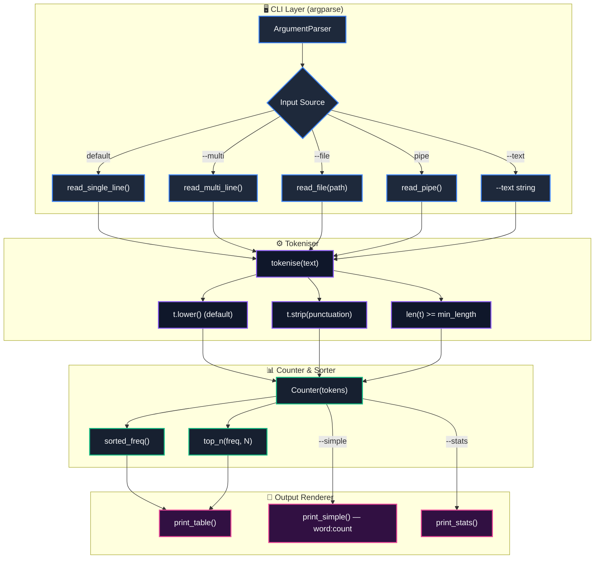
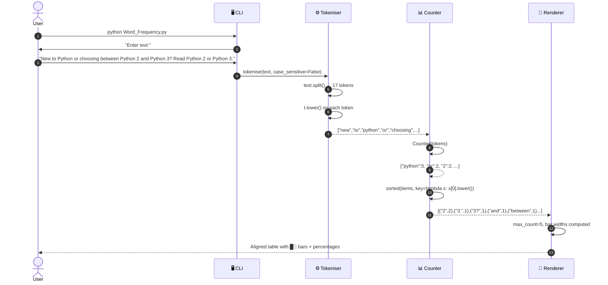
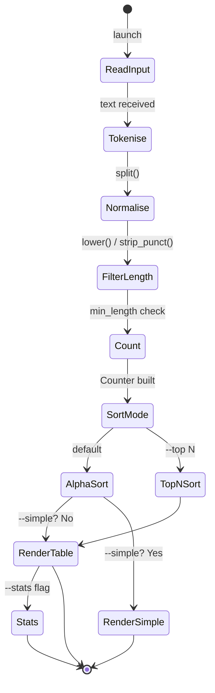

<div align="center">

# 📝 3D Word Frequency Counter & Lexical Analysis Engine
### *Zero-Dependency Python Standard Library • `collections.Counter` • Alphanumeric Sort • Bar Chart • Multi-Mode Input*


-brightgreen.svg?style=for-the-badge)


<p align="center">
  <b>A fully-featured Word Frequency Counter built on Python's standard library.
  Counts word occurrences, sorts alphanumerically, renders an ANSI bar-chart table,
  and supports four input modes: interactive stdin, multi-line, file, pipe, and inline text.
  Includes case-normalisation, punctuation stripping, top-N filtering, and vocabulary statistics.</b>
</p>

</div>

---

## 🧊 3D Layered Architecture & Isometric Pipeline

```
                     +-------------------------------------------------------+
                    /                                                         /|
                   /         [🖥️ LAYER 1: INPUT & CLI CUBE]                  / |
                  /   argparse • 4 input modes • pipe detection             /  |
                 +-------------------------------------------------------+   +
                 |                                                       |  /|
                 |  stdin (single line)   →  input() prompt              | / |
                 |  --multi               →  read until EOF              |/  |
                 |  --file PATH           →  Path.read_text()            |   +
                 |  --text "STR"          →  inline argument             |  /|
                 |  pipe (echo | python)  →  sys.stdin.read()            | / |
                 +-------------------------------------------------------+/
                                         |
                                         v
                     +-------------------------------------------------------+
                    /                                                         /|
                   /       [⚙️ LAYER 2: TOKENISER & NORMALISER CUBE]          / |
                  /   str.split • strip punct • lower • min_length filter   /  |
                 +-------------------------------------------------------+   +
                 |                                                       |  /|
                 |  text.split()          →  raw token list              | / |
                 |  t.strip(punctuation)  →  clean token (--strip-punct) |/  |
                 |  t.lower()             →  normalise (default)         |   +
                 |  len(t) >= min_length  →  length filter               |  /
                 +-------------------------------------------------------+ /
                                         |
                                         v
                     +-------------------------------------------------------+
                    /                                                         /|
                   /         [📊 LAYER 3: COUNTER & SORTER CUBE]             / |
                  /   collections.Counter • sorted() • most_common()       /  |
                 +-------------------------------------------------------+   +
                 |                                                       |  /|
                 |  Counter(tokens)       →  {word: frequency} map       | / |
                 |  sorted(freq.items())  →  alphanumeric order          |/  |
                 |  freq.most_common(N)   →  top-N by count              |   +
                 +-------------------------------------------------------+  /
                                         |
                                         v
                     +-------------------------------------------------------+
                    /                                                         /|
                   /       [🎨 LAYER 4: ANSI TABLE RENDER CUBE]               / |
                  /   aligned columns • █░ bar chart • stats panel          /  |
                 +-------------------------------------------------------+   +
                 |                                                       |  /
                 |  Word column: max-width auto-pad                      | /
                 |  Bar: filled = round(count/max × 24)                  |/
                 |  --simple: plain word:count (exercise format)         |
                 +-------------------------------------------------------+
```

---

## 📐 3D Frequency Space & Lexical Geometry

A corpus of $N$ total words containing $V$ unique types is modelled as a **frequency vector**:

```
     Frequency ▲
               │
           5   ┤  █████████████████████████  Python
               │
           2   ┤  ████████████              2 / or
               │
           1   ┤  ██████                   New/Read/and/between/choosing/to/3./3?
               │
           0   └──┬──────┬──────┬──────┬──────┬──────► Word (sorted alphanumerically)
                 "2"   "3." "3?" "New" "Py…" "Read" …
```

### Mathematical Foundations

#### 1. Word Frequency

For a text with tokens $w_1, w_2, \ldots, w_N$, the frequency of word $w$ is:

$$f(w) = \sum_{i=1}^{N} \mathbb{I}(w_i = w)$$

#### 2. Relative Frequency (Percentage)

$$p(w) = \frac{f(w)}{N} \times 100\%$$

#### 3. Vocabulary Richness (Type-Token Ratio)

$$\text{TTR} = \frac{V}{N} \times 100\% \quad \text{where } V = |\{w : f(w) > 0\}|$$

A TTR of 100% means every word is unique; lower TTR indicates higher repetition.

#### 4. Bar Width Mapping

Each word's bar width $b$ within a column of `W=24` characters:

$$b(w) = \left\lfloor \frac{f(w)}{f_{\max}} \times W \right\rceil$$

#### 5. Alphanumeric Sort Key

Sorting is case-insensitive by default:

$$\text{key}(w) = w.\text{lower}()$$

This ensures `New < Python < Read < and` (not ASCII order where uppercase < lowercase).

---

## 🌟 Visual System Architecture (Mermaid)

### 1. Component Architecture



---

### 2. Word Counting Sequence



---

### 3. Processing Pipeline State



---

## 🎨 Rich Terminal UI Mockups

### 1. Classic Exercise Output (`--simple`)

```text
$ python Word_Frequency.py --simple
  Enter text: New to Python or choosing between Python 2 and Python 3? Read Python 2 or Python 3.

2:2
3.:1
3?:1
New:1
Python:5
Read:1
and:1
between:1
choosing:1
or:2
to:1
```

### 2. Full Table with Bar Chart (default)

```text
$ python Word_Frequency.py
  Enter text: New to Python or choosing between Python 2 and Python 3? Read Python 2 or Python 3.

════════════════════════════════════════════════════════════
  📝  Word Frequency — Alphanumeric Order
════════════════════════════════════════════════════════════

  Word          Count  Bar
  ──────────────────────────────────────────────────────
  2                 2  ██████████░░░░░░░░░░░░░░   11.8%
  3.                1  █████░░░░░░░░░░░░░░░░░░░░    5.9%
  3?                1  █████░░░░░░░░░░░░░░░░░░░░    5.9%
  and               1  █████░░░░░░░░░░░░░░░░░░░░    5.9%
  between           1  █████░░░░░░░░░░░░░░░░░░░░    5.9%
  choosing          1  █████░░░░░░░░░░░░░░░░░░░░    5.9%
  new               1  █████░░░░░░░░░░░░░░░░░░░░    5.9%
  or                2  ██████████░░░░░░░░░░░░░░   11.8%
  python            5  ████████████████████████   29.4%
  read              1  █████░░░░░░░░░░░░░░░░░░░░    5.9%
  to                1  █████░░░░░░░░░░░░░░░░░░░░    5.9%

  Total words: 17  |  Unique words: 11
```

### 3. Top-N Most Frequent Words

```text
$ python Word_Frequency.py --text "to be or not to be that is the question" --top 5

  Word       Count  Bar
  ───────────────────────────────────────────────────
  to             2  ████████████████████░░░░   20.0%
  be             2  ████████████████████░░░░   20.0%
  or             1  ██████████░░░░░░░░░░░░░░   10.0%
  not            1  ██████████░░░░░░░░░░░░░░   10.0%
  that           1  ██████████░░░░░░░░░░░░░░   10.0%

  Total words: 10  |  Unique words: 8
```

### 4. Stats Mode

```text
$ python Word_Frequency.py --text "..." --stats

  Statistics
  ────────────────────────────────────────
  Total words            17
  Unique words           11
  Vocabulary richness    64.7%  (unique/total)

  Most common:
    python → 5×
    or → 2×
    2 → 2×

  Least common:
    to → 1×
    read → 1×
    new → 1×
```

### 5. With `--strip-punct` (clean tokens)

```text
$ python Word_Frequency.py --strip-punct --simple
  Enter text: New to Python or choosing between Python 2 and Python 3? Read Python 2 or Python 3.

2:2
3:2       ← "3?" and "3." merged into "3" after stripping punctuation
and:1
between:1
choosing:1
new:1
or:2
python:5
read:1
to:1
```

---

## ✨ Feature Overview

### 1. 📊 `collections.Counter`
Single-call frequency counting — `Counter(tokens)` does the heavy lifting.

### 2. 🔤 Case Normalisation
Default: folds all words to lowercase before counting (`Python` = `python`).
Use `--case-sensitive` to treat them as distinct.

### 3. ✂️ Punctuation Stripping
`--strip-punct` calls `token.strip(string.punctuation)` — merges `3?` and `3.` into `3`.

### 4. 🔢 Top-N Mode
`--top N` uses `Counter.most_common(N)` — O(N log N) heap selection, not full sort.

### 5. 📺 Four Input Modes

| Mode | Trigger | Use Case |
|---|---|---|
| Interactive | default | Classroom / quick test |
| Multi-line | `--multi` | Paste paragraphs |
| File | `--file path.txt` | Process documents |
| Pipe | `echo "..." \|` | Shell scripting |
| Inline | `--text "..."` | One-liner |

### 6. 🎨 ANSI Bar Chart
Bar width proportional to frequency — green for the highest, dimmed for low counts. Disable with `--no-bar`.

---

## 💻 Complete Command Reference

| Flag | Description | Example |
|:---|:---|:---|
| *(default)* | Single line from stdin | `python Word_Frequency.py` |
| `--multi` | Multi-line until EOF | `python Word_Frequency.py --multi` |
| `--file PATH` | Read from text file | `python Word_Frequency.py --file story.txt` |
| `--text STRING` | Inline text | `python Word_Frequency.py --text "hello world"` |
| `--top N` | Top N words by count | `python Word_Frequency.py --top 5` |
| `--case-sensitive` | No case folding | `python Word_Frequency.py --case-sensitive` |
| `--strip-punct` | Strip punctuation | `python Word_Frequency.py --strip-punct` |
| `--min-length N` | Skip short words | `python Word_Frequency.py --min-length 3` |
| `--simple` | Plain `word:count` output | `python Word_Frequency.py --simple` |
| `--no-bar` | Hide bar chart | `python Word_Frequency.py --no-bar` |
| `--stats` | Vocabulary statistics | `python Word_Frequency.py --stats` |
| `--no-colour` | Disable ANSI | `python Word_Frequency.py --no-colour` |

---

## 🛡️ Error Handling

| Scenario | Exit | Message |
|:---|:---:|:---|
| Empty input | `1` | `Error: No input text provided.` |
| File not found | `1` | `Error: File not found: path.txt` |
| No words after filtering | `1` | `Error: No words found after processing.` |

---

## 🚀 Setup & Usage

No installation required — zero external dependencies.

```bash
# Classic exercise — single line, plain output
python Word_Frequency.py --simple

# Rich table with bar chart
python Word_Frequency.py

# From a file
python Word_Frequency.py --file story.txt --strip-punct --stats

# Top 10 most common words
python Word_Frequency.py --file novel.txt --strip-punct --top 10

# Pipe mode
echo "one fish two fish red fish blue fish" | python Word_Frequency.py --simple

# Skip words shorter than 3 chars (drop "a", "in", "to" etc.)
python Word_Frequency.py --file article.txt --min-length 3

# Case-sensitive (Python ≠ python)
python Word_Frequency.py --case-sensitive

# Windows PowerShell pipe
Get-Content story.txt | python Word_Frequency.py --simple
```

---

## 📁 Project Structure

```
50 Mini Projects/
└── Word_Frequency.py
    ├── tokenise(text, ...)         ← split • lower • strip_punct • min_length
    ├── count_words(text, ...)      ← Counter(tokenise(text))
    ├── sorted_freq(freq)           ← sorted by word.lower() alphanumerically
    ├── top_n(freq, n)              ← freq.most_common(n)
    │
    ├── read_single_line()          ← input() prompt
    ├── read_multi_line()           ← stdin until EOFError
    ├── read_file(path)             ← Path.read_text()
    ├── read_pipe()                 ← sys.stdin.read()
    │
    ├── print_header(title)         ← ANSI bordered header
    ├── print_table(pairs)          ← aligned table + █░ bar chart
    ├── print_simple(pairs)         ← word:count exercise format
    ├── print_stats(freq)           ← TTR, most/least common
    │
    ├── build_parser()              ← argparse CLI definition
    └── main()                      ← Entry point (exit code 0/1)
```

---

## 📜 Complete Terminal Demo

```bash
# 1. Original exercise — exact expected output
$ python Word_Frequency.py --simple
  Enter text: New to Python or choosing between Python 2 and Python 3? Read Python 2 or Python 3.
2:2
3.:1
3?:1
New:1
Python:5
Read:1
and:1
between:1
choosing:1
or:2
to:1

# 2. Same input but strip punctuation (merges 3?/3.)
$ python Word_Frequency.py --strip-punct --simple
  Enter text: New to Python or choosing between Python 2 and Python 3? Read Python 2 or Python 3.
2:2
3:2
and:1
between:1
choosing:1
new:1
or:2
python:5
read:1
to:1

# 3. Pipe a file and get top 5
$ cat poem.txt | python Word_Frequency.py --strip-punct --top 5

  Word      Count  Bar
  ─────────────────────────────────────────────
  the           8  ████████████████████████   18.6%
  and           5  ███████████████░░░░░░░░░   11.6%
  of            4  ████████████░░░░░░░░░░░░    9.3%
  a             3  █████████░░░░░░░░░░░░░░░    7.0%
  in            3  █████████░░░░░░░░░░░░░░░    7.0%

# 4. Rich stats output
$ python Word_Frequency.py --text "to be or not to be" --stats

  Vocabulary richness    66.7%
  Most common:  be → 2×, to → 2×, or → 1×
```

---

## 🧩 Design Decisions

| Decision | Rationale |
|:---|:---|
| **`collections.Counter`** | Built-in frequency map — faster and more readable than manual `dict.get()` |
| **`sorted(key=str.lower)`** | Case-insensitive alpha sort matches human expectations (New before or) |
| **`Counter.most_common(N)`** | O(N log N) heap selection — faster than sorting full dict for top-N |
| **4 input modes** | Covers interactive use, batch processing, shell scripting, and testing |
| **`--simple` flag** | Reproduces exact original exercise output format without changing core logic |
| **Punctuation stripping** | Opt-in via `--strip-punct` — default preserves `3?` and `3.` as the exercise expects |
| **`--min-length`** | Practical for NLP — skip stopwords `a`, `I`, `to` without a stopword list |
| **`raise SystemExit(main())`** | Propagates exit codes correctly on all platforms |
