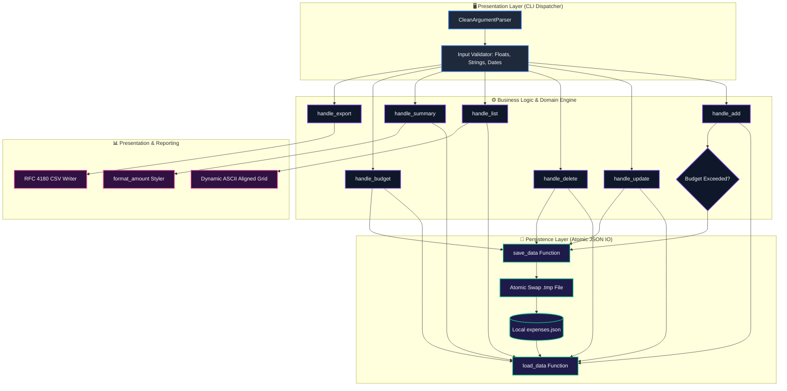
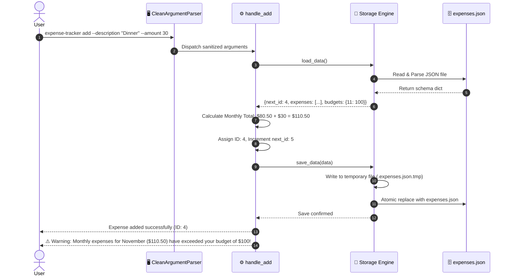
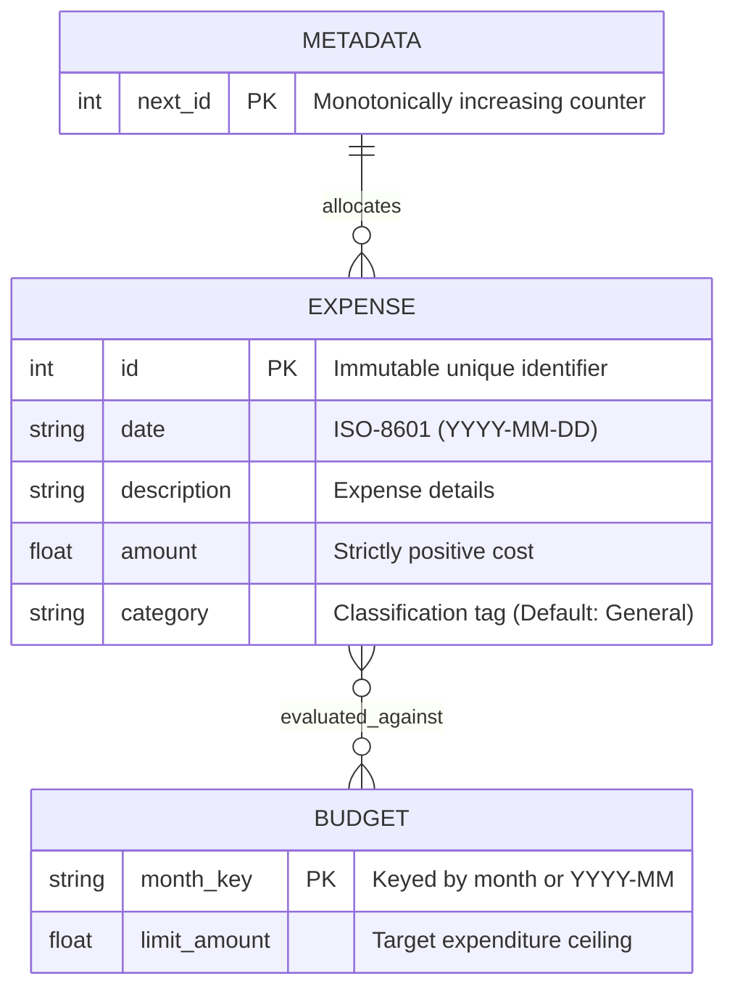

<div align="center">

# 🧊 3D Command-Line Expense Tracker & Financial Intelligence Engine
### *Zero-Dependency Python Standard Library • Atomic JSON Persistence • Dynamic Budget Guardrails • Category Intelligence*

[](https://roadmap.sh/projects/expense-tracker)
[](https://github.com/Paradoxai77/Expense-tracker-)


-brightgreen.svg?style=for-the-badge)


<p align="center">
  <b>An enterprise-grade, standard-library-only Command-Line Interface (CLI) application for personal expense tracking, monthly budget threshold monitoring, category classification, atomic local persistence, and CSV export.</b>
</p>

<p align="center">
  <b>Project URL:</b> <a href="https://roadmap.sh/projects/expense-tracker">https://roadmap.sh/projects/expense-tracker</a><br>
  <b>GitHub Repository:</b> <a href="https://github.com/Paradoxai77/Expense-tracker-">https://github.com/Paradoxai77/Expense-tracker-</a>
</p>

</div>

---

## 🔗 Project Information & URLs

- **Roadmap.sh Challenge URL:** https://roadmap.sh/projects/expense-tracker
- **GitHub Repository URL:** https://github.com/Paradoxai77/Expense-tracker-

---

## 🧊 3D Layered Architecture & Isometric Pipeline

```
                               +-------------------------------------------------------------+
                              /                                                             /|
                             /          [📦 LAYER 1: CLI PRESENTATION & PARSING CUBE]       / |
                            /  CleanArgumentParser • Subcommands • Strict Validation Engine/  |
                           +-------------------------------------------------------------+   +
                           |                                                             |  /|
                           |  • Commands: add, update, delete, list, summary, budget, exp| / |
                           |  • Validation: Positive Floats, Non-Empty Text, Month 1-12  |/  |
                           +-------------------------------------------------------------+   +
                                                          |
                                                          v
                               +-------------------------------------------------------------+
                              /                                                             /|
                             /       [🛡️ LAYER 2: BUSINESS LOGIC & GUARDRAILS CUBE]        / |
                            /   ID Monotonic Auto-Increment • Budget Overrun Detection    /  |
                           +-------------------------------------------------------------+   +
                           |                                                             |  /|
                           |  • ID Generator: Monotonic integer sequence (Never Reused)  | / |
                           |  • Budget Monitor: Real-time sum vs threshold calculation   |/  |
                           |  • Temporal Filter: ISO 8601 YYYY-MM-DD current-year filter |   +
                           +-------------------------------------------------------------+  /
                                                          |
                                                          v
                               +-------------------------------------------------------------+
                              /                                                             /|
                             /         [💾 LAYER 3: ATOMIC DATA PERSISTENCE CUBE]           / |
                            /       Local expenses.json • Atomic Swap Engine (.tmp -> dst)/  |
                           +-------------------------------------------------------------+   +
                           |                                                             |  /|
                           |  • Schema Integrity: Corrupted & Empty File Fallback Guard  | / |
                           |  • Atomic Replace: os.replace prevents race partial writes  |/  |
                           |  • Zero Dependencies: Standard library json & os primitives|   +
                           +-------------------------------------------------------------+  /
                                                          |
                                                          v
                               +-------------------------------------------------------------+
                              /                                                             /|
                             /       [📊 LAYER 4: ANALYTICS, CSV EXPORT & RENDERING]        / |
                            /    Dynamic Aligned ASCII Tables • RFC 4180 CSV Serializer     /  |
                           +-------------------------------------------------------------+   +
                           |                                                             |  /
                           |  • Currency Styler: Integer-truncating formatter ($20/$20.50)| / 
                           |  • Visual Grid: Max-width column padding & category filters |/  
                           |  • CSV Engine: RFC 4180 standard multi-record streaming     |   
                           +-------------------------------------------------------------+   
```

---

## 📐 3D Financial Geometric Space & Budget Vector Dynamics

Expenses are modeled as vectors within a **3-Dimensional Financial Coordinate Space** $(\text{Category } \mathbb{R}^k, \text{Timeline } t, \text{Expenditure } \$)$:

```
          Expenditure ($ Amount) ▲
                                 │
                                 │                 ▲ Budget Threshold Ceiling B(m)
                                 │                ╱ [Plane: Maximum Monthly Allowance]
                                 │               ╱──────────────/────────────────────────/
                                 │              ╱              /                        /
                                 │             ╱              /  * Breach: $110.50     /
                                 │            ╱              /  (Warning Triggered!)  /
                                 │           ╱              /────────────────────────/
                                 │          ╱              ▲
                                 │         ╱              │  Vector e₄ (+$30 Banquet)
                                 │        ╱               │
                                 │       ╱          ● e₃ ($45.50 Groceries)
                                 │      ╱          ╱
                                 │     ╱     ● e₂ ($10 Dinner)
                                 │    ╱     ╱
                                 │   ╱ ● e₁ ($25 Lunch)
                                 │  ╱
                                 │ ╱
                                 └────────────────────────────────────────► Category Axis
                                ╱                                           [Food, Utilities, Travel]
                               ╱
                              ╱
                             ▼ Temporal Timeline (Days of Month)
```

### Mathematical Foundations

#### 1. Current-Year Monthly Expense Accumulation
Given a set of expenses $E = \{e_1, e_2, \dots, e_n\}$, the monthly aggregated expenditure $M(m, Y)$ for month $m \in [1, 12]$ and current year $Y = \text{year}(\text{today})$ is:
$$M(m, Y) = \sum_{e \in E} \text{amount}(e) \cdot \mathbb{I}\Big(\text{year}(e.\text{date}) = Y \;\land\; \text{month}(e.\text{date}) = m\Big)$$

#### 2. Dynamic Budget Guardrail Condition
Let $B(m)$ be the configured budget for month $m$. When an expense $e_{\text{new}}$ is submitted:
$$\Delta B = \left( M(m, Y) + \text{amount}(e_{\text{new}}) \right) - B(m)$$
$$\text{Trigger Warning if: } \Delta B > 0$$

#### 3. Currency Display Normalization Function
To eliminate noisy trailing zeroes while maintaining accounting precision:
$$f(x) = \begin{cases} 
\$\lfloor x \rfloor & \text{if } x = \lfloor x \rfloor \\
\$\left( x \text{ to 2 decimals} \right) & \text{otherwise}
\end{cases}$$

---

## 🌟 Visual System Architecture (Mermaid)

### 1. Layered Component Architecture



---

### 2. Add Expense & Budget Guardrail Sequence



---

### 3. Entity-Relationship Data Model



---

## 🎨 Rich Terminal UI Mockups

### 1. Active Expense Aligned Grid View (`list`)
```text
┌─────────────────────────────────────────────────────────────────────────────┐
│                             EXPENSE LEDGER VIEW                             │
├─────┬────────────┬─────────────────────────────┬─────────────┬──────────────┤
│ ID  │ Date       │ Description                 │ Category    │ Amount       │
├─────┼────────────┼─────────────────────────────┼─────────────┼──────────────┤
│ 1   │ 2026-11-04 │ Late lunch                  │ General     │ $25          │
│ 3   │ 2026-11-04 │ Whole Foods Groceries       │ Food        │ $45.50       │
│ 4   │ 2026-11-04 │ Dinner Banquet              │ General     │ $30          │
│ 5   │ 2026-11-04 │ Espresso & Bakery           │ Food        │ $5           │
└─────┴────────────┴─────────────────────────────┴─────────────┴──────────────┘
```

### 2. Real-Time Monthly Budget Gauge (`summary`)
```text
┌─────────────────────────── November Budget Monitor ─────────────────────────┐
│ Target Budget Ceiling:   $100.00                                            │
│ Current Recorded Total:  $105.50                                            │
│ Status:                  OVER BUDGET (+$5.50) [105.5%]                      │
└─────────────────────────────────────────────────────────────────────────────┘
Budget Gauge: [████████████████████████████████████████████!░░░] 105.5% EXCEEDED
```

### 3. Category Spending Breakdown
```text
Food         [============================================] $50.50  (47.9%)
General      [====================================        ] $55.00  (52.1%)
Transport    [                                            ] $0.00   ( 0.0%)
Utilities    [                                            ] $0.00   ( 0.0%)
```

---

## ✨ Features Overview

### 1. ➕ Core Expense Management
- **Auto-Incrementing IDs**: Primary keys start at `1` and monotonically increase. Even after an expense is deleted, its ID is **never recycled**, preventing reference collisions.
- **Atomic Persistence**: Database updates write to a temporary swap file before executing an `os.replace` atomic filesystem swap, safeguarding against file truncation or write interrupts.
- **Consistent Currencies**: Automatically displays whole numbers cleanly (e.g. `$20`) and fractional sums with accounting precision (e.g. `$20.50`).

### 2. 🏷️ Category Intelligence
- **Default Category**: Defaults automatically to `"General"` when omitted.
- **Custom Categorization**: Tag expenses on creation (`--category Food`, `--category Utilities`).
- **Targeted Listing**: Query expenses exclusively by category (`list --category Food`).

### 3. 🛡️ Budget Threshold Guardrails
- **Monthly Targets**: Set granular budgets per calendar month (`budget --month 11 --amount 100`).
- **Real-Time Guardrail Alerts**: Emits immediate, color-coded terminal alerts if an incoming expense breaches the active month's allowance.

### 4. 📈 Calendar-Aware Summaries
- **All-Time Summary**: Sums total lifetime spending across all recorded items.
- **Current-Year Month Aggregation**: Evaluates expenses exclusively within the active calendar year when filtered with `--month <M>`.

### 5. 📤 RFC 4180 CSV Export
- Generates standards-compliant CSV files (`export --file expenses.csv`) complete with header rows for seamless import into Excel, Google Sheets, or data analytics pipelines.

---

## 💻 Complete Command Reference

| Command | Arguments | Flags | Description | Example |
| :--- | :--- | :--- | :--- | :--- |
| **`add`** | `--description`, `--amount` | `--category` | Record a new expense with auto-generated ID | `expense-tracker add --description "Lunch" --amount 20` |
| **`update`** | `--id` | `--description`, `--amount`, `--category` | Modify description, amount, or category of an existing record | `expense-tracker update --id 1 --amount 25` |
| **`delete`** | `--id` | None | Remove expense permanently by unique ID | `expense-tracker delete --id 2` |
| **`list`** | None | `--category` | Render an aligned tabular grid of expenses | `expense-tracker list --category Food` |
| **`summary`** | None | `--month` | Compute total expenditure or filtered monthly sum | `expense-tracker summary --month 11` |
| **`budget`** | `--month`, `--amount` | None | Configure monthly budget spending limit | `expense-tracker budget --month 11 --amount 500` |
| **`export`** | `--file` | None | Export all records to RFC 4180 CSV file | `expense-tracker export --file expenses.csv` |

---

## 🛡️ Error Handling & Defensive Resilience

The CLI rejects malformed input and filesystem anomalies gracefully with informative, single-line error messages and appropriate exit codes:

| Scenario | Trigger Command | Exit Code | Diagnostic Message |
| :--- | :--- | :---: | :--- |
| **Non-numeric amount** | `add --amount abc` | `1` | `Error: Invalid amount 'abc'. Amount must be a valid number.` |
| **Zero or negative amount** | `add --amount -10` | `1` | `Error: Amount must be a positive number greater than 0.` |
| **Empty description string** | `add --description "   "` | `1` | `Error: Description cannot be empty.` |
| **Non-existent ID** | `delete --id 999` | `1` | `Error: Expense with ID 999 not found.` |
| **Missing update arguments** | `update --id 1` | `1` | `Error: At least one of --description, --amount, or --category must be provided to update.` |
| **Month out of bounds** | `summary --month 13` | `1` | `Error: Invalid month '13'. Month must be an integer between 1 and 12.` |
| **Corrupted data file** | Malformed JSON syntax | `1` | `Error: Data file 'expenses.json' is corrupted or contains invalid JSON: ...` |
| **Empty data file** | 0-byte file | `1` | `Error: Data file 'expenses.json' is empty. Please check or reset the file.` |
| **Missing required arguments** | `add --amount 20` | `2` | `Error: the following arguments are required: --description` |

---

## 🚀 Installation & Command Setup

### Option 1: Standard Python Package Installation (Recommended)

Install locally in editable mode via [`pyproject.toml`](file:///c:/Users/LOKI/Practice/Python/50%20Mini%20Projects/pyproject.toml):

```bash
pip install -e .
```

You can now invoke `expense-tracker` anywhere in your terminal:

```bash
expense-tracker --help
```

---

### Option 2: Linux / macOS Executable Script (Shebang + chmod)

[`expense_tracker.py`](file:///c:/Users/LOKI/Practice/Python/50%20Mini%20Projects/expense_tracker.py) contains a standard POSIX shebang (`#!/usr/bin/env python3`):

```bash
# Make the Python file executable
chmod +x expense_tracker.py

# Create a symlink in your local bin path
ln -s "$(pwd)/expense_tracker.py" /usr/local/bin/expense-tracker

# Alternatively, use the included shell wrapper
chmod +x expense-tracker
ln -s "$(pwd)/expense-tracker" /usr/local/bin/expense-tracker
```

---

### Option 3: Windows Batch Wrapper

On Windows, use the native [`expense-tracker.bat`](file:///c:/Users/LOKI/Practice/Python/50%20Mini%20Projects/expense-tracker.bat):

```cmd
.\expense-tracker.bat list
```

> [!TIP]
> Add the project folder to your Windows system `PATH` to invoke `expense-tracker <command>` directly from any command prompt or PowerShell window.

---

### Option 4: Direct Python Execution

Execute directly with the Python interpreter:

```bash
python expense_tracker.py <command> [options]
```

---

## 🧪 Comprehensive Unit Test Suite

The test suite in [`tests/test_expense_tracker.py`](file:///c:/Users/LOKI/Practice/Python/50%20Mini%20Projects/tests/test_expense_tracker.py) runs on Python's built-in `unittest` runner:

```bash
python -m unittest discover tests -v
```

### Test Suite Execution Report

```text
test_add_basic (test_expense_tracker.TestExpenseTracker) ... ok
test_add_empty_description_error (test_expense_tracker.TestExpenseTracker) ... ok
test_add_multiple_auto_increment_ids (test_expense_tracker.TestExpenseTracker) ... ok
test_add_negative_and_zero_amount_error (test_expense_tracker.TestExpenseTracker) ... ok
test_add_non_numeric_amount_error (test_expense_tracker.TestExpenseTracker) ... ok
test_add_with_category_and_float_amount (test_expense_tracker.TestExpenseTracker) ... ok
test_budget_setting (test_expense_tracker.TestExpenseTracker) ... ok
test_budget_warning_on_exceed (test_expense_tracker.TestExpenseTracker) ... ok
test_corrupted_json_file (test_expense_tracker.TestExpenseTracker) ... ok
test_csv_export (test_expense_tracker.TestExpenseTracker) ... ok
test_delete_id_never_reused (test_expense_tracker.TestExpenseTracker) ... ok
test_delete_non_existent_id (test_expense_tracker.TestExpenseTracker) ... ok
test_delete_success (test_expense_tracker.TestExpenseTracker) ... ok
test_empty_json_file (test_expense_tracker.TestExpenseTracker) ... ok
test_invalid_month_range (test_expense_tracker.TestExpenseTracker) ... ok
test_list_all_table_format (test_expense_tracker.TestExpenseTracker) ... ok
test_list_empty (test_expense_tracker.TestExpenseTracker) ... ok
test_list_filter_category (test_expense_tracker.TestExpenseTracker) ... ok
test_missing_required_arguments (test_expense_tracker.TestExpenseTracker) ... ok
test_summary_monthly_current_year (test_expense_tracker.TestExpenseTracker) ... ok
test_summary_total (test_expense_tracker.TestExpenseTracker) ... ok
test_update_category (test_expense_tracker.TestExpenseTracker) ... ok
test_update_description_and_amount (test_expense_tracker.TestExpenseTracker) ... ok
test_update_missing_all_fields (test_expense_tracker.TestExpenseTracker) ... ok
test_update_non_existent_id (test_expense_tracker.TestExpenseTracker) ... ok
test_update_single_field (test_expense_tracker.TestExpenseTracker) ... ok

----------------------------------------------------------------------
Ran 26 tests in 0.098s

OK
```

---

## 📜 Complete Terminal Demonstration

```bash
# 1. Record initial expenses
$ expense-tracker add --description "Lunch" --amount 20
Expense added successfully (ID: 1)

$ expense-tracker add --description "Dinner" --amount 10
Expense added successfully (ID: 2)

$ expense-tracker add --description "Groceries" --amount 45.50 --category Food
Expense added successfully (ID: 3)

# 2. View aligned ledger
$ expense-tracker list
ID  Date        Description  Category  Amount
1   2026-11-04  Lunch        General   $20   
2   2026-11-04  Dinner       General   $10   
3   2026-11-04  Groceries    Food      $45.50

# 3. Filter by category
$ expense-tracker list --category Food
ID  Date        Description  Category  Amount
3   2026-11-04  Groceries    Food      $45.50

# 4. Modify expense
$ expense-tracker update --id 1 --description "Late lunch" --amount 25
Expense updated successfully

# 5. Review lifetime and monthly totals
$ expense-tracker summary
Total expenses: $80.50

$ expense-tracker summary --month 11
Total expenses for November: $80.50

# 6. Configure monthly budget threshold
$ expense-tracker budget --month 11 --amount 100
Budget for November set to $100

# 7. Add expense exceeding the budget ceiling
$ expense-tracker add --description "Dinner banquet" --amount 30
Expense added successfully (ID: 4)
Warning: Monthly expenses for November ($110.50) have exceeded your budget of $100!

# 8. Delete record and verify ID monotonicity
$ expense-tracker delete --id 2
Expense deleted successfully

$ expense-tracker add --description "Coffee" --amount 5
Expense added successfully (ID: 5)
Warning: Monthly expenses for November ($105.50) have exceeded your budget of $100!

# 9. Export ledger to CSV
$ expense-tracker export --file expenses.csv
Expenses exported successfully to expenses.csv
```
